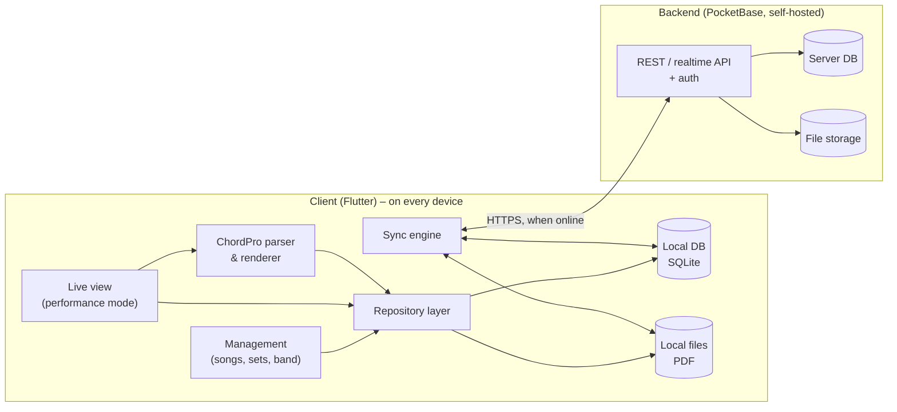
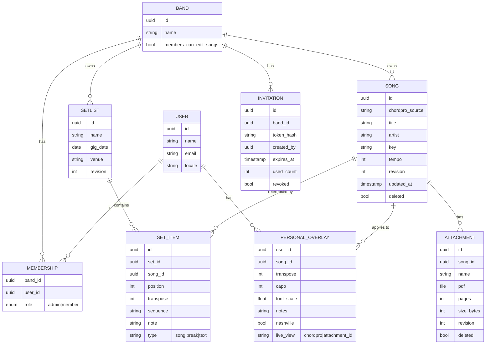

# BandChords – Architecture

> Status: **Draft for discussion** (most core decisions accepted) · Last updated: 2026-11-14
>
> This document describes the overall architecture. Individual decisions are recorded
> as Architecture Decision Records (ADRs) in [`adr/`](adr/).

## 1. Goal and context

BandChords is an app that lets bands see the chords of their songs on tablets
(Android, iOS, Windows) while performing – similar to SongBook Pro, but focused on
**sets that are managed together** within a band.

- Songs are stored in **ChordPro format**; PDF sheet music can be attached.
- A responsible person (e.g. the band leader) **creates sets** and adds songs to them.
- All band members **see the sets** on their own device and play from them live.
- The user interface is available in **German and English**, selectable in the settings.

### Actors

| Role | Responsibilities |
|---|---|
| **Admin / band leader** | Manage the band, invite members, create/edit songs, put sets together. A band can have several admins. |
| **Member** | View sets and use them live, personal adjustments (transposition, notes, font size); edit songs if enabled for the band |

A user can be a member of several bands; the role is defined per band (ADR-0005).

## 2. Quality goals (prioritized)

1. **Reliability on stage** – The app must work without a network. No loading, no login, no crash during a performance.
2. **Readability and live usability** – Large, legible display, page turns via foot pedal or swipe, screen stays on.
3. **Easy management** – A set can be put together in a few minutes and is available to all members.
4. **Platform independence** – One code base for Android, iOS and Windows.
5. **Open data format** – ChordPro files can always be imported and exported, no lock-in.

## 3. Solution strategy (overview)

| Topic | Approach | ADR |
|---|---|---|
| Operating mode | **Offline-first**: local database and PDF files on every device, sync when a network is available | [ADR-0001](adr/0001-offline-first.md) |
| Client technology | **Flutter** (one code base for Android, iOS, Windows; optionally web/macOS) | [ADR-0002](adr/0002-client-flutter.md) |
| Data format | **ChordPro as the source of truth**, parsing and rendering in the client; display notation B/H selectable, Nashville numbers | [ADR-0003](adr/0003-chordpro-source-format.md) |
| Backend & sync | **PocketBase**, self-hosted on an existing server, revision-based sync | [ADR-0004](adr/0004-backend-and-sync.md) |
| Management | **One app with roles** instead of a separate management application | [ADR-0005](adr/0005-single-app-with-roles.md) |
| Personal settings | **Overlay model**: personal adjustments never change the shared ChordPro text | [ADR-0006](adr/0006-personal-overlays.md) |
| Live mode | Pedal/keyboard control, wakelock; each member navigates independently (**no leader sync**) | [ADR-0007](adr/0007-live-mode.md) |
| Localization | UI in **German (Swiss, `de-CH`) and English**, selectable in the settings | [ADR-0008](adr/0008-localization.md) |
| Sheet music | **PDF attachments** per song, synced and available offline, shown in live mode | [ADR-0009](adr/0009-pdf-attachments.md) |
| ChordPro coverage | **Whole specification** (transpose, grids, markup, conditionals, diagrams, images, delegated environments) | [ADR-0012](adr/0012-full-chordpro-support.md) |
| SongSelect (CCLI) | **No API integration** (partner program closed); manual import of ChordPro files downloaded from SongSelect | [ADR-0011](adr/0011-songselect-import.md) |
| Printable set list | PDF generated in the client with the `pdf` package, embedded font, saved via the save dialog; no print plugin yet | [ADR-0013](adr/0013-printable-set-list.md) |

## 4. Building block view

### Client modules

| Module | Responsibility |
|---|---|
| `chordpro` | Parser (ChordPro → AST), chord model, transposition, Nashville conversion, metadata extraction. Pure Dart package without UI dependencies, easy to test. |
| `render` | Rendering the AST: chords above lyrics, sections (verse/chorus), one or two columns, auto-fit, notation B/H, Nashville numbers |
| `pdf` | Displaying PDF attachments (fit to width/page, two-page view) |
| `data` | Local DB (SQLite, e.g. via `drift`), repositories, domain model |
| `sync` | Sync between local DB and backend, conflict handling, offline queue |
| `live` | Performance mode: full screen, wakelock, pedal/keyboard control, set navigation |
| `manage` | Create/import songs, ChordPro editor with preview, put sets together |
| `band` | Login, band selection, invitations, roles |
| `l10n` | UI translations (German, English) and language setting |

## 5. Domain model (draft)

Notes:

- **`SONG.chordpro_source`** is the single source of truth. `title`, `artist`, `key` and `tempo` are extracted from the ChordPro directives (`{title}`, `{artist}`, `{key}`, `{tempo}`) on save and stored redundantly only for search and sorting.
- **`SET_ITEM`** allows set-specific adjustments (e.g. one tone lower tonight) and non-song entries (break, announcement, encore separator).
- **IDs are UUIDs** generated by the client – required for creating records offline without a server.
- **`revision`** and **`deleted`** (soft delete) are the basis for sync (see ADR-0004).
- **`ATTACHMENT`** holds PDF sheet music; a song can also consist of attachments only, without ChordPro text (ADR-0009).
- **`USER.locale`** is optional and only used as a default for new devices; the language is set per device (see ADR-0008).

## 6. Key flows

### Preparing and distributing a set

1. The band leader creates a set, adds songs and reorders them via drag & drop.
2. Changes are written to the local DB immediately and synced as soon as the device is online.
3. Member devices fetch changes (realtime push, or on app start / pull-to-refresh).
4. For each set the app shows an **"Offline ready ✓"** status once all songs of the set and their PDF attachments are available locally and up to date.

### Joining a band

1. An admin creates an invitation link in the app and shares it (group chat) or shows it as a QR code.
2. The invitee opens the link → the app opens via deep link (or the link is pasted in the app), signs in or registers if needed.
3. The server validates the token and creates the membership with the member role; the band's data is synced to the device.

### Performance

1. A member opens the set → live mode (full screen, screen stays on).
2. Page turns via foot pedal (Bluetooth HID, sends keys such as arrows / Page Up / Page Down), tap or swipe.
3. At the end of a song, "next" automatically moves to the next song in the set.
4. While in live mode, **no** sync operations change what is displayed (changes are applied after leaving live mode, or only announced discreetly).

## 7. Cross-cutting concerns

- **Security:** Authentication via PocketBase (email/password or magic link); data is only accessible within the user's own bands, and write permissions follow the role per band (backend access rules). The auth token is stored locally so no new login is needed offline.
- **Import/export:** Import of `.cho`/`.chordpro`/`.chopro`/`.txt` files (individually and as ZIP, optionally converting German H/B notation) and PDF attachments; export of a set as a ZIP with ChordPro files and PDF attachments; the set list as text (file or clipboard) and as a printable PDF (ADR-0013), one line per song with title, key for the set and sequence.
- **Localization:** UI in German and English, selectable in the settings (ADR-0008). Song content is not translated.
- **Testability:** `chordpro` package with extensive unit tests (parser, transposition); golden tests for rendering.
- **Data protection:** Self-hosting keeps the data under the band's own control (e.g. in Switzerland).

## 8. Phases / roadmap (proposal)

| Phase | Scope |
|---|---|
| **MVP** ✅ | ChordPro parser & renderer (notation B/H, Nashville), local song library, PDF attachments, creating sets, live mode with pedal, import/export, German/English UI – initially **without** a backend (single device) |
| **Phase 1** | Backend, login, bands & roles (several admins, several bands per user), sync of songs, sets and PDF files incl. conflict handling |
| **Phase 2** | Synced personal overlays |
| **Later** | Freehand annotations (stylus), metronome/count-in, MIDI control, web client for management |

### MVP status (2026-11-14)

The MVP is implemented in [`app/`](../../app) and [`packages/chordpro/`](../../packages/chordpro)
and runs locally on a single device (no backend yet). Simplifications compared to the
target state described in the ADRs, to be completed in later phases:

| Topic | MVP | Target (ADR) |
|---|---|---|
| Personal notes | One text note per song, shown above the song | Notes anchored to a line/section (ADR-0006) |
| Pedal keys | Fixed mapping: arrows, Page Up/Down, Space, Enter, Backspace | Configurable mapping (ADR-0007) |
| Auto-scroll | Not implemented | Optional auto-scroll by tempo/duration (ADR-0007) |
| PDF display | One page at a time, fit to width | Two pages side by side in landscape (ADR-0009) |
| Bands & roles | One implicit local band, all features available | Roles per band via backend (ADR-0005, phase 1) |

Verified with unit and widget tests (`tool/check.sh`) and rendered screenshots;
not yet built or run on a physical Android, iOS or Windows device.

## 9. Open questions

See "Open points" in the individual ADRs. The most important:

1. ~~Client technology?~~ → Flutter (ADR-0002, accepted)
2. ~~Self-hosting or cloud service?~~ → PocketBase, self-hosted on an existing server (ADR-0004). Open: server details (OS, Docker, domain/HTTPS)
3. ~~UI language?~~ → Swiss Standard German (`de-CH`) and English, selectable in the settings (ADR-0008)
4. ~~May members edit songs?~~ → Configurable per band, default admins only; sets by admins only (ADR-0005)
5. ~~Several bands per user?~~ → Yes; several admins per band; no guest role (ADR-0005)
6. ~~Leader sync?~~ → Not needed, each member navigates independently (ADR-0007)
7. ~~German chord notation?~~ → Display setting B/H, storage international; Nashville numbers supported; no chord diagrams (ADR-0003)
8. ~~Attachments offline?~~ → PDF sheet music yes, audio no (ADR-0001, ADR-0009)
9. ~~Invitation flow?~~ → Invitation link (reusable, 7 days, revocable, member role) plus QR code (ADR-0005)
10. ~~PDF details?~~ → All attachments on every device, max. 20 MB per PDF, PDF-only songs allowed, local PDFs in the MVP (ADR-0009)
11. Server details: OS, Docker, public domain/HTTPS – also needed for deep links of invitation links (ADR-0004, ADR-0005)
12. App name and domain – "BandChords" is a working title; candidates in [`docs/app-name-candidates.md`](../app-name-candidates.md)
13. ~~May agents merge their own PRs?~~ → Yes, from the start, but only when all tests pass (test gate, ADR-0010). Open: repository host and name
14. ~~SongSelect import?~~ → No API integration, manual ChordPro import (ADR-0011, accepted). Open: test with a real SongSelect file, show copyright/CCLI number?
15. ~~Printable set list?~~ → PDF in the client with the `pdf` package and embedded Noto Sans (ADR-0013, accepted). Open: Letter paper, export options, native print dialog

## 10. ADR index

| No. | Title | Status |
|---|---|---|
| [0001](adr/0001-offline-first.md) | Offline-first architecture | Accepted |
| [0002](adr/0002-client-flutter.md) | Flutter as client framework | Accepted |
| [0003](adr/0003-chordpro-source-format.md) | ChordPro as source format, parsing in the client | Accepted |
| [0004](adr/0004-backend-and-sync.md) | Backend and synchronization | Accepted |
| [0005](adr/0005-single-app-with-roles.md) | One app with roles instead of a separate management app | Accepted |
| [0006](adr/0006-personal-overlays.md) | Personal adjustments as overlays | Accepted |
| [0007](adr/0007-live-mode.md) | Live mode, no leader sync | Accepted |
| [0008](adr/0008-localization.md) | Localization (German/English) | Accepted |
| [0009](adr/0009-pdf-attachments.md) | PDF sheet music attachments | Accepted |
| [0010](adr/0010-git-workflow.md) | Git workflow for autonomous agents | Accepted |
| [0011](adr/0011-songselect-import.md) | Song import from CCLI SongSelect | Accepted |
| [0012](adr/0012-full-chordpro-support.md) | Full ChordPro specification support | Accepted |
| [0013](adr/0013-printable-set-list.md) | Printable set list as PDF | Accepted |

New ADRs are based on the template [`adr/template.md`](adr/template.md). Documentation and ADRs are written in English.
