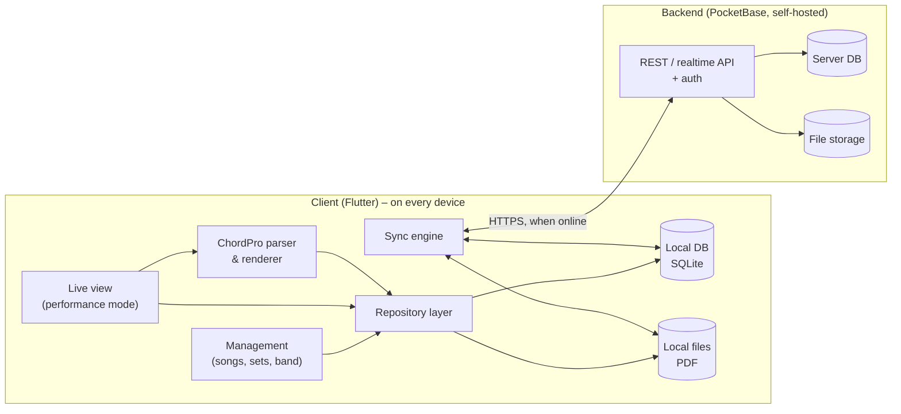
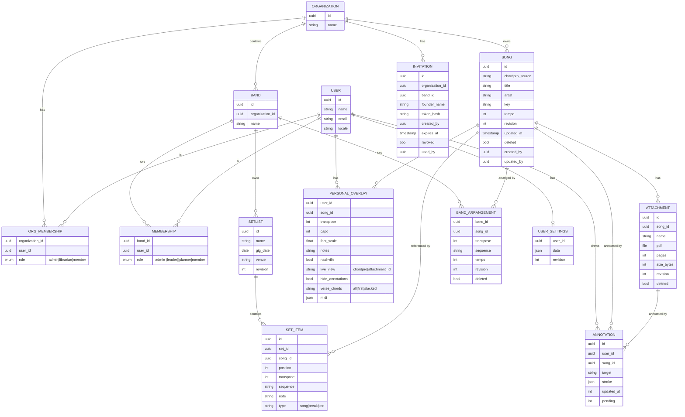

# setDING – Architecture

> Status: **Draft for discussion** (most core decisions accepted) · Last updated: 2026-11-18
>
> This document describes the overall architecture. Individual decisions are recorded
> as Architecture Decision Records (ADRs) in [`adr/`](adr/).

## 1. Goal and context

setDING (called RealChord until 2026-11-17, working title until 2026-11-15: BandChords) is an app that lets bands see the chords of their songs on tablets
(Android, iOS, Windows) while performing – similar to SongBook Pro, but focused on
**sets that are managed together** within a band.

- Songs are stored in **ChordPro format**; PDF sheet music can be attached.
- A responsible person (e.g. the band leader) **creates sets** and adds songs to them.
- All band members **see the sets** on their own device and play from them live.
- The user interface is available in **German and English**, selectable in the settings.

### Actors

| Role | Responsibilities |
|---|---|
| **Organization admin** | Manage the organization (e.g. a music school or a church with several bands): invite people, create bands, manage all its bands and its song library; may do everything |
| **Librarian** *(organization)* | Create, import, edit and delete the organization's songs and attachments |
| **Band leader** (stored as band `admin`) | Manage the band, add organization members to it, invite people into it, put sets together, create new songs and edit their own. A band can have several leaders. |
| **Set planner** *(band)* | Create, edit, reorder and delete the band's sets |
| **Member** | View sets and use them live, personal adjustments (transposition, notes, font size) |

A user can be a member of several organizations and bands; roles are defined per organization and per band (ADR-0005, ADR-0017). ADR-0023 (accepted) refines them: organization roles admin > librarian > member, band roles leader (`admin`) > set planner > member; organization admins keep all rights. The bands of an organization share its song library; nothing is shared across organizations, and users only see the people of their own organizations.

## 2. Quality goals (prioritized)

1. **Reliability on stage** – The app must work without a network. No loading, no login, no crash during a performance.
2. **Readability and live usability** – Large, legible display, page turns via tap, swipe, Bluetooth page turner or keyboard, screen stays on.
3. **Easy management** – A set can be put together in a few minutes and is available to all members.
4. **Platform independence** – One code base for Android, iOS and Windows.
5. **Open data format** – ChordPro files can always be imported and exported, no lock-in.

## 3. Solution strategy (overview)

| Topic | Approach | ADR |
|---|---|---|
| Operating mode | **Offline-first**: local database and PDF files on every device, sync when a network is available | [ADR-0001](adr/0001-offline-first.md) |
| Client technology | **Flutter** (one code base for Android, iOS, Windows; optionally web/macOS) | [ADR-0002](adr/0002-client-flutter.md) |
| Data format | **ChordPro as the source of truth**, parsing and rendering in the client; display notation B/H selectable, Nashville numbers | [ADR-0003](adr/0003-chordpro-source-format.md) |
| Backend & sync | **PocketBase**, self-hosted on an existing server, revision-based sync | [ADR-0004](adr/0004-backend-and-sync.md) |
| Management | **One app with roles** instead of a separate management application | [ADR-0005](adr/0005-single-app-with-roles.md) |
| Personal settings | **Overlay model**: personal adjustments never change the shared ChordPro text (e.g. key, capo, Nashville, chords in the first verse only or verses stacked line by line); per user (`local` for the local library), synced with the account | [ADR-0006](adr/0006-personal-overlays.md), [ADR-0020](adr/0020-overlays-per-user.md), [ADR-0040](adr/0040-stacked-verses.md) |
| Freehand annotations | Personal pen, highlighter and stamp marks, drawn in live mode on ChordPro and PDF pages; stored in **page coordinates** with a layout fingerprint (exact on the stage device, free arrows possible) and a **line anchor** as fallback for other layouts; PDF strokes per page; per song, private, synced as one record per person, song and target, **merged per stroke** on the server; editable with eraser, lasso and undo; band annotations later | [ADR-0032](adr/0032-freehand-annotations.md) |
| Settings sync | Settings split into **personal** (instrument, voice, notation, chord style, display, theme, language, drummer preferences; synced with the account, last writer wins per key) and **device** (font size, columns, live appearance, server, sync mode, click volume and latency; never synced); fixed per setting and shown in the settings | [ADR-0027](adr/0027-personal-settings-sync.md) |
| MIDI program change | In live mode the **personal keyboard program** of the current song (raw bank select and program change in the personal overlay, own server field `overlays.midi`) is sent to one keyboard over **USB**; device profiles (Nord Stage 3 with programs or Nord songs, generic), output and channel are device settings; a "Test" button sends a song's program on request; a prototype on all platforms with a real Nord comes first; Android, Windows, Linux and web (Chrome/Edge), iOS with the iOS app | [ADR-0039](adr/0039-midi-program-change.md) |
| Band arrangements | New layer between song and set item: per band and song a key (transposition), sequence and tempo, maintained by band leaders and set planners, synced per band with last writer wins; set item transposition becomes relative to the band's key | [ADR-0025](adr/0025-band-arrangements.md) |
| Drummer mode | Drums instrument preset; beat display and count-in in live mode; **click on the in-ear** from a looped one-bar audio buffer (`flutter_soloud`, the audio is the clock), latency compensation; automatic or manual start, long press of the forward pedal or Enter; tempo on stage only for the evening; song map layout for drums, on phones only the beat and the set | [ADR-0026](adr/0026-drummer-mode.md) |
| Live mode | Page turns by tap, swipe, Bluetooth page turner or keyboard, wakelock (set again on return to the app, a failure is shown), next song prepared ahead in idle time (no work in the frames of a turn), progress bar of the set with the pages of the current song, stage appearance (dark/black) independent of the app theme; each member navigates independently (**no leader sync**) | [ADR-0007](adr/0007-live-mode.md) |
| Localization | UI in **German (Swiss, `de-CH`) and English**, selectable in the settings | [ADR-0008](adr/0008-localization.md) |
| Sheet music | **PDF attachments** per song, synced and available offline, shown in live mode | [ADR-0009](adr/0009-pdf-attachments.md) |
| Chord display style | Suffix parsed into quality, extension and alterations; **device setting** *As written* / *Standard* / *Jazz* plus optional superscript, combinable with B/H and Nashville; source unchanged | [ADR-0022](adr/0022-chord-display-style.md) |
| Song display styles | Personal **Song display** settings: Standard style plus seven fixed section types (intro, verse, pre-chorus, chorus, bridge, interlude, outro) derived from the section name, each with its own style or **inheriting from a chosen type**; chords, lyrics, heading, indent bar and tint; curated palette with light and dark tones; presets; explicit colours beat song directives, inline markup always wins; live mode and song view, not the editor preview | [ADR-0033](adr/0033-song-display-styles.md) |
| ChordPro coverage | **Whole specification** (transpose, grids, markup, conditionals, diagrams, images, delegated environments) | [ADR-0012](adr/0012-full-chordpro-support.md) |
| SongSelect (CCLI) | **No API integration** (partner program closed); manual import of ChordPro files downloaded from SongSelect | [ADR-0011](adr/0011-songselect-import.md) |
| Server hosting | **Debian LXC** on Proxmox, PocketBase as systemd service, published via **Cloudflare Tunnel**, daily backups, provisioned with `make server-install`, updated after each release with `make server-release` (from the tag, version stamped, only after a green release build) | [ADR-0014](adr/0014-server-hosting.md) |
| Sign-in & session | Email/password via `SyncBackend` (PocketBase SDK, pinned), session in secure storage, kept while offline, refreshed when online, 30-day tokens | [ADR-0016](adr/0016-client-authentication.md) |
| Update check | Installed release builds ask their server (`latestClientVersion` in `/api/setding/config`) 5 s after the start, at most daily; a **dot** on the settings, a tile under *Storage & info* and **one SnackBar per version**, never in live mode, no dialog | [ADR-0036](adr/0036-update-check.md) |
| Windows TLS trust | The Windows client trusts the system roots **plus the bundled ISRG roots X1/X2** (Let's Encrypt), since Windows adds missing roots only on demand and Dart does not trigger that | [ADR-0034](adr/0034-bundled-root-certificates.md) |
| Registration | Server operator sets `SETDING_REGISTRATION` = `invite_only` (default: sign-up only with an invitation, new organizations only via operator **founder invitations**) or `open`, and `SETDING_EMAIL_VERIFICATION` = `off` (default) or `required` (needs SMTP); no in-app super-admin; rate limits on sign-up and invitations | [ADR-0024](adr/0024-registration-mode.md) |
| Organizations | Bands belong to an **organization** that owns the shared song library; organization admins manage people and bands; created automatically for a single band | [ADR-0017](adr/0017-organizations.md) |
| Finer-grained roles | Ordered fixed roles: organization admin > **librarian** > member, band leader > **set planner** > member; organization admins may do everything; librarians edit the library (replaces `members_can_edit_songs`), band leaders create new songs and edit only their own; leaders may invite into their band | [ADR-0023](adr/0023-finer-grained-roles.md) |
| Server data model | PocketBase collections as migrations, server-wide revision counter, set items as JSON, access rules per role, tested against a real PocketBase | [ADR-0015](adr/0015-server-data-model.md) |
| Printable set list | PDF generated in the client with the `pdf` package, embedded font, saved via the save dialog; no print plugin yet | [ADR-0013](adr/0013-printable-set-list.md) |
| Web client | **Flutter web build of the same app** for management without installation, served by PocketBase (`pb_public`) at `app.setding.app`, same sync engine, sign-in required, ChordPro file import but no export, no offline guarantee in the browser ([guide](../development/web.md)) | [ADR-0018](adr/0018-web-client.md) |
| Website & user docs | **Astro Starlight** in `website/` (de-CH root, en under `/en/`), landing page and user documentation at `setding.app`, built in `make check` with link validation, served by **Caddy** on the server behind the tunnel, deployed with the `make server-*` targets | [ADR-0030](adr/0030-website-and-user-docs.md) |
| Linux release | `make release`: Linux release built in a **Debian container** (baseline glibc, ISA check) from the committed state ([guide](../development/releases.md)) | [ADR-0019](adr/0019-linux-release-builds.md) |
| Linux AppImage | The release build also packs the bundle as an **AppImage** (appimagetool and type-2 runtime pinned by checksum) next to the tar.gz; the AppImage takes the newer version from the update check (ADR-0036) and, after a tap on *Install*, downloads the new AppImage, checks it against `SHA256SUMS`, replaces its own file in one step and restarts | [ADR-0038](adr/0038-linux-appimage-self-update.md) |
| Release builds | A `vX.Y.Z` tag builds **Linux, Android and Windows** on GitHub Actions and publishes a GitHub Release; Android APK (arm64 only) signed with a stable release key (repository secrets), installed and updated with **Obtainium**; build number = the workflow's run number, shared by releases and manual test builds (none in `pubspec.yaml`); a release is done when its build passed and the server is deployed from the tag ([guide](../development/releases.md)) | [ADR-0021](adr/0021-release-builds-github-actions.md) |
| Windows distribution | **Inno Setup installer** (per user, no admin rights) next to the zip; the installed app takes the newer version from the update check (ADR-0036) and, after a tap on *Install*, downloads the setup from the GitHub release, checks it against `SHA256SUMS` and installs it silently; no code signing (SmartScreen warns once at the first install) | [ADR-0035](adr/0035-windows-installer-self-update.md) |
| SBOM | One **CycloneDX** SBOM per release asset (`<asset>.cdx.json`), generated by the own Dart tool `tool/sbom` and listing only what the asset ships (compiled Dart packages, bundled assets, plugins and native libraries of the platform, Gradle release classpath via the CycloneDX Gradle plugin, Flutter, Windows runtime and installer, AppImage runtime); validated with cyclonedx-cli; `metadata.component` names `setDING` with the tag version, the asset's SHA-256, platform, build and commit; the release fails if name, version or hash do not match; vulnerabilities and licences are evaluated on GitHub (Dependabot, dependency review) | [ADR-0037](adr/0037-sbom-cyclonedx.md) |
| Versioning | **Semantic Versioning** for the whole product (apps, web client, server): major = old clients no longer work with the server or data (all devices must update), minor = features old clients tolerate, patch = fixes; before 1.0.0 minor also covers incompatible changes; CalVer considered and not chosen ([guide](../development/releases.md)) | [ADR-0028](adr/0028-versioning-scheme.md) |
| Minimum client version | Clients send `X-Setding-Version`; the server refuses versions below `MIN_CLIENT_VERSION` (in the hooks, raised with an incompatible change) with **HTTP 426**; the app shows "Please update setDING" above the navigation and on the sign-in screen, keeps the session and local changes, stops the automatic sync; release before deploying the server | [ADR-0029](adr/0029-minimum-client-version.md) |

## 4. Building block view

### Client modules

| Module | Responsibility |
|---|---|
| `chordpro` | Parser (ChordPro → AST), chord model (incl. structured suffix, ADR-0022), transposition, Nashville conversion, metadata extraction. Pure Dart package without UI dependencies, easy to test. |
| `render` | Rendering the AST: chords above lyrics, sections (verse/chorus), one or more columns, auto-fit with song pages in live mode, notation B/H, Nashville numbers, chord style with raised extensions (ADR-0022), song display styles per section type (ADR-0033) |
| `pdf` | Displaying PDF attachments (fit to width/page, two-page view) |
| `data` | Local DB (SQLite, e.g. via `drift`), repositories, domain model |
| `sync` | Sync between local DB and backend, conflict handling, offline queue. `SyncEngine` runs the order of a sync; the parts per kind of record live in `app/lib/sync/engine/` (songs with conflicts, sets, attachments with downloads, personal adjustments, shared cursors and outbox) |
| `live` | Performance mode: full screen, wakelock, page turns by tap, swipe, page turner or keyboard, set navigation; beat display, count-in, tempo on stage and song map of the drummer mode (ADR-0026) |
| `audio` | Click of the drummer mode: one bar rendered as WAV and looped by SoLoud on its engine clock, beat timeline, latency calibration (ADR-0026) |
| `manage` | Create/import songs, ChordPro editor with syntax highlighting, a form for the main metadata (title, key, tempo, …), line numbers (tap to select lines), bracket matching, autocompletion, moving lines and chords (also by mouse drag and drop), line tools and undo/redo buttons, search and replace with highlighted matches, converting chords-above-lyrics text, coloured section backgrounds, tap in the preview to jump to the source, a warning on save for invalid ChordPro and preview, put sets together |
| `annotations` | Personal freehand annotations (ADR-0032): placement in place or at the anchor line, the layer that paints and takes stylus input, drawing mode state (tools, selection, undo/redo) and its toolbar (`app/lib/ui/annotations/`) |
| `band` | Login, band selection, invitations, roles |
| `update` | Updates of the Windows app installed with the setup (ADR-0035) and of the Linux AppImage (ADR-0038): takes the version from the update check (ADR-0036), downloads the setup or AppImage of that release, verifies it against `SHA256SUMS`, then runs the setup silently or replaces the AppImage (`lib/update/`, `lib/platform/self_update_io.dart`) |
| `l10n` | UI translations (German, English) and language setting |

## 5. Domain model (draft)

Notes:

- **`SONG.chordpro_source`** is the single source of truth. `title`, `artist`, `key` and `tempo` are extracted from the ChordPro directives (`{title}`, `{artist}`, `{key}`, `{tempo}`) on save and stored redundantly only for search and sorting; likewise the raw song sequence (`{x_sequence}`, `songs.sequence`, schema 13) so that the song list can show it without loading the ChordPro text. Song sources (recordings on YouTube, Spotify, …) are `{x_link: URL | Label}` directives in the ChordPro text, shown in a side panel of the song view (ADR-0012, #469). On the device, a full-text index (SQLite FTS5) covers title, artist and the lyrics without chords (`songs.search_text`); the search matches the beginnings of words, ignoring accents. The song list highlights the hits in title and artist and shows a snippet of the lyrics around a hit; both come from the index itself (FTS5 `highlight()` / `snippet()`), so highlighting follows the same rules as the search. The song list can be sorted by title, artist, key (C to B, major before minor) or last edit, chosen with a chip at the start of the filter row and stored per device; title and artist (`{sorttitle}` / `{sortartist}` first) are compared ignoring case and accents, with section headers for the first letter, the artist or the key. From 900 px width (tablets in landscape, desktop) the list has two columns; section headers span both, and a song still opens full-screen. Small status icons at the end of each song show an open sync conflict, the next set of the current band with a gig date from today on, and songs with sheet music (PDF) only, i.e. without ChordPro text. For people who may edit the song, a warning icon marks songs whose ChordPro probably does not show as intended (`validateChordPro`); the count is derived on the device (`songs.chordpro_problems`, schema 14, not synced), and the import, the song, sets and the set overview report it too (ADR-0003, #314).
- **`SETLIST.gig_date`** orders the sets tab in three sections: *Upcoming* (from today on, ascending; the next gig first and highlighted with the days until it), *Without date* (by name) and *Past* (most recent first; collapsed by default, the user's choice to expand or collapse is stored per device; collapsing only hides the cards, a selected past set stays shown next to the list on wide screens and is never expanded automatically). A gig today counts as upcoming, as for the song list's upcoming-gig icon.
- **`SET_ITEM`** allows set-specific adjustments (e.g. one tone lower tonight) and non-song entries (break, announcement, encore separator).
- **IDs are UUIDs** generated by the client – required for creating records offline without a server.
- **`revision`** and **`deleted`** (soft delete) are the basis for sync (see ADR-0004). Deleting a song, set, set item or attachment can be undone for a few seconds from a message with "Undo"; the restore is a normal change with a new revision, attachment files are deleted only once the undo is gone, and the server restores the adjustments and arrangements a song's deletion removed (ADR-0004, ADR-0015, #267).
- **`ATTACHMENT`** holds PDF sheet music; a song can also consist of attachments only, without ChordPro text (ADR-0009).
- **On the server** (ADR-0015) set items are stored as a JSON array in the set (`setlists.items`), so a set is always synced as a whole; attachments carry a redundant `band`; songs store only the ChordPro text and the title (other metadata is derived in the client); revisions come from one server-wide counter. Collections: `users`, `organizations`, `org_memberships`, `bands`, `memberships`, `songs`, `attachments`, `setlists`, `overlays` (personal adjustments, private per user, ADR-0020; the keyboard program in its own field `midi`, ADR-0039), `annotations` (freehand annotations, private per user, merged per stroke, ADR-0032), `user_settings` (personal settings, private per user, merged per key, ADR-0027), `invites`.
- **`ANNOTATION`** (ADR-0032) is one personal freehand stroke or stamp, per song: on a ChordPro song in page coordinates of live mode with the page's layout fingerprint, plus a line anchor (source line, text fingerprint, repeat index) used when the layout differs; on a PDF attachment in normalized page coordinates. On the server the strokes of a person for a song and target are one `annotations` record, merged per stroke ID like `user_settings`.
- **`USER_SETTINGS`** (ADR-0027) holds the personal settings of a user as JSON, private to the user and merged per key; device settings stay on the device.
- **`USER.locale`** is optional and no longer used: the language is a personal setting synced with the account (ADR-0008, ADR-0027).

## 6. Key flows

### Preparing and distributing a set

1. The band leader creates a set, adds songs and reorders them via drag & drop.
2. Changes are written to the local DB immediately and synced according to the device's sync setting: at app start (default), automatically, or manually with "Sync now" or by pulling down the list of sets or songs (signed in only, #384). Requests the server rejects for its rate limits are retried after growing waits, so large imports sync completely (ADR-0004, #303).
3. Member devices fetch changes the same way (at start, with "Sync now" or pull to refresh, or in automatic mode on realtime events).
4. For each set the app shows an **"Offline ready ✓"** status once all songs of the set and their PDF attachments are available locally and up to date.

### Joining a band

1. An admin creates an invitation link in the app and shares it (group chat) or shows it as a QR code.
2. The invitee opens the link → the app opens via deep link (or the link is pasted in the app), signs in or registers if needed.
3. The server validates the token and creates the membership with the member role; the band's data is synced to the device.

### Performance

1. A member opens the set → live mode (full screen, screen stays on).
2. Page turns via tap, swipe or a Bluetooth page turner / keyboard (right arrow, down arrow, Page Down, Space forward; left arrow, up arrow, Page Up back; ADR-0007).
3. At the end of a song, "next" automatically moves to the next song in the set.
4. While in live mode, **no** sync operations change what is displayed (changes are applied after leaving live mode, or only announced discreetly).

## 7. Cross-cutting concerns

- **Security:** Authentication via PocketBase (email/password, ADR-0016); data is only accessible within the user's own bands, and write permissions follow the role per band (backend access rules, ADR-0015). The session is kept in the platform's secure storage and stays valid offline, so no new login is needed on stage.
- **Import/export:** Import of `.cho`/`.chordpro`/`.chopro`/`.txt` files (individually and as ZIP, optionally converting German H/B notation; songs with ChordPro problems are reported and can be fixed automatically) and PDF attachments; export of a set as a ZIP with ChordPro files and PDF attachments; the set list as text (file or clipboard) and as a printable PDF (ADR-0013), one line per song with title, key for the set and sequence.
- **Localization:** UI in German and English, selectable in the settings (ADR-0008). Song content is not translated.
- **Settings:** grouped into categories: account & sync and, when signed in, *Organization & bands* (the organizations with their bands, join, new band; what a user may change depends on the role, ADR-0023) on top, then *Personal – on all your devices* (general, musician, display; synced with the account, ADR-0027) and *This device* (screen & live mode, storage & info; never synced), each group and category marked with a cloud or device icon and an explanation line. Wide screens list the categories on the left and show the selected one next to them; narrow screens open each category as its own page (`app/lib/ui/settings_screen.dart`).
- **Sets:** from 900 px width (the same breakpoint as the song list's two columns) the sets tab shows the list of sets on the left and the selected set (items, actions, offline status) next to it, by default the next gig; the selection is kept outside the widgets, so it survives rotating a tablet. Narrow screens open a set as its own page; songs and live mode always open full screen (`app/lib/ui/sets/sets_screen.dart`).
- **Testability:** `chordpro` package with extensive unit tests (parser, transposition); golden tests for rendering. Performance on a real Android device is measured with `make perf` (profile build, timelines of song list, search, live mode and editor; [guide](../development/performance.md), first results in #270).
- **Diagnostics:** named loggers (`app/lib/util/log.dart`, no extra package) write to the console (also in release builds) and the Dart developer log, and keep the last 300 messages; the settings copy them to the clipboard for support. Logs contain no song content or credentials.
- **Licence:** the project is MIT-licensed ([`LICENSE`](../../LICENSE)); the code is largely AI-generated. Dependencies and bundled assets must be MIT-compatible (e.g. Noto Sans under the SIL Open Font License, ADR-0013).
- **Data protection:** Self-hosting keeps the data under the band's own control (e.g. in Switzerland).

## 8. Phases / roadmap (proposal)

| Phase | Scope |
|---|---|
| **MVP** ✅ | ChordPro parser & renderer (notation B/H, Nashville), local song library, PDF attachments, creating sets, live mode, import/export, German/English UI – initially **without** a backend (single device) |
| **Phase 1** | Backend, login, bands & roles (several admins, several bands per user), sync of songs, sets and PDF files incl. conflict handling |
| **Phase 2** ✅ | Web client for management at `app.setding.app` (ADR-0018; done in #27), synced personal overlays (per user, ADR-0020; done in #81, #82) |
| **Website** | Landing page and user documentation at `setding.app` (ADR-0030, #388): skeleton with first steps and installation; remaining chapters, privacy policy and legal notice follow |
| **Towards version 1** | Re-enable CI as a required check on every PR and push to `main` (manual-only during early development, ADR-0010), branch protection; release builds for Linux, Android and Windows exist (ADR-0021), Windows installer with in-app updates (ADR-0035), CycloneDX SBOM per release asset (ADR-0037), iOS open; then release **1.0.0** (ADR-0028) |
| **Freehand annotations** ✅ | Personal freehand notes on songs and PDF pages, synced and editable (ADR-0032, implemented in #428) |
| **Song display styles** ✅ | Personal styles per section type for live mode and the song view (ADR-0033, implemented in #473–#476, #471) |
| **Later** | Configurable page turner key mapping, band annotations shared with the band (follow-up of ADR-0032), MIDI program change per song in live mode (ADR-0039, accepted; prototype first), MIDI page turning |

### MVP status (2026-11-14)

The MVP is implemented in [`app/`](../../app) and [`packages/chordpro/`](../../packages/chordpro)
and runs locally on a single device (no backend yet). Simplifications compared to the
target state described in the ADRs, to be completed in later phases:

| Topic | MVP | Target (ADR) |
|---|---|---|
| Personal notes | One text note per song, shown above the song | Notes anchored to a line/section (ADR-0006) |
| Pedal keys | Fixed mapping (#261, #286): right arrow, down arrow, Page Down, Space forward; left arrow, up arrow, Page Up back; a held key turns once | Configurable mapping, possibly later (ADR-0007) |
| Auto-scroll | Not implemented | Optional auto-scroll by tempo/duration (ADR-0007) |
| PDF display | Done (#150): portrait one page fit to width, landscape two pages side by side | Two pages side by side in landscape (ADR-0009) |
| Bands & roles | One implicit local band, all features available | Roles per band via backend (ADR-0005, phase 1); done in #15, the MVP band became the local library |

Verified with unit and widget tests (`tool/check.sh`) and rendered screenshots;
not yet built or run on a physical Android, iOS or Windows device.

### Phase 1 status (2026-11-15)

Tracked as issues #13–#18 (schema, sign-in, bands and roles, invitations,
song/set sync, PDF sync).

- **Server schema (#13):** collections, access rules and hooks in [`server/`](../../server)
  (ADR-0015, accepted), tested against a real PocketBase in `make check`; `make backend`
  starts a local instance. Deployed to `api.setding.app`.
- **Sign-in (#14):** account section in the settings (sign up, sign in, sign out,
  password reset, server URL) behind the `SyncBackend` interface; session in the
  platform's secure storage, kept while offline (ADR-0016, accepted). Password reset
  needs SMTP on the server (open). Bands, sync and invitations follow (#15–#18).
- **Organizations (#21):** server model with organizations and a shared song library
  per organization (ADR-0017, accepted), deployed.
- **Bands and roles in the app (#15):** organizations, bands, members and roles are
  loaded from the server and cached locally (schema 4: `organizations`,
  `org_memberships`, `memberships`; songs belong to a library = organization or the
  local library "On this device"). Band switcher grouped by organization, band and
  organization screens (settings, roles, add members, leave), UI actions gated by
  role, copying songs and sets from the local library into a band. Songs and sets of
  bands stay on the device until sync (#17). Since #167 the songs tab has its own
  **library switcher** (local library and organizations, independent of the band);
  the band switcher stays on the sets tab.
- **Invitations (#16):** organization admins create links (7 days, reusable,
  revocable) shown with a QR code; people join via deep link or by pasting the link
  (Bands → Join). Landing page and verification files on the server; verified App
  Links / Universal Links need the signing details (open, see ADR-0005).
- **Sync of songs and sets (#17):** outbox, delta pull per organization/band, push with
  base revision, conflict dialog for songs, last writer wins for sets, realtime
  triggers, paused in live mode; sync status and "Sync now" in the settings, pull to refresh on the lists of sets and songs (ADR-0004).
- **PDF sync (#18):** attachments uploaded after their songs and downloaded on every
  device in the same run; missing files shown in live mode and the settings
  (ADR-0009). Images for `{image}` stay local (open). **Phase 1 is complete.**

## 9. Open questions

See "Open points" in the individual ADRs. The most important:

1. ~~Client technology?~~ → Flutter (ADR-0002, accepted)
2. ~~Self-hosting or cloud service?~~ → PocketBase, self-hosted on an existing server (ADR-0004). Server details: see question 11
3. ~~UI language?~~ → Swiss Standard German (`de-CH`) and English, selectable in the settings (ADR-0008)
4. ~~May members edit songs?~~ → Configurable per band, default admins only; sets by admins only (ADR-0005)
5. ~~Several bands per user?~~ → Yes; several admins per band; no guest role (ADR-0005)
6. ~~Leader sync?~~ → Not needed, each member navigates independently (ADR-0007)
7. ~~German chord notation?~~ → Display setting B/H, storage international; Nashville numbers supported; no chord diagrams (ADR-0003)
8. ~~Attachments offline?~~ → PDF sheet music yes, audio no (ADR-0001, ADR-0009)
9. ~~Invitation flow?~~ → Invitation link (reusable, 7 days, revocable, member role) plus QR code (ADR-0005)
10. ~~PDF details?~~ → All attachments on every device, max. 20 MB per PDF, PDF-only songs allowed, local PDFs in the MVP (ADR-0009)
11. ~~Server details?~~ → Debian LXC on Proxmox, Cloudflare Tunnel, daily backups, `make server-*` targets (ADR-0014, accepted; [operations guide](../operations/server.md)). Production: `api.setding.app`. Open: staging container, monitoring
12. ~~App name and domain?~~ → **setDING** (renamed from RealChord on 2026-11-17, #318, because the app is extended for drummers), domain `setding.app` ([`docs/app-name-candidates.md`](../app-name-candidates.md)). Code identifiers renamed; application ID `app.setding`. Open: register the domain, new logo (#319), trademark check (swissreg/EUIPO)
13. ~~May agents merge their own PRs?~~ → Yes, from the start, but only when all tests pass (test gate, ADR-0010). Host: GitHub, `github.com/tafli/setDING` (moved from a self-hosted Forgejo with the issue numbers kept, history rewritten, #116/#129). Every change in its own git worktree, the project folder stays on `main`. Agents use `gh`; commits are signed with the owner's identity; during early development the test gate runs locally and CI (GitHub Actions) is manual-only. Open: re-enable CI as a required check towards version 1, build jobs, branch protection
14. ~~SongSelect import?~~ → No API integration, manual ChordPro import (ADR-0011, accepted). Open: test with a real SongSelect file, show copyright/CCLI number?
15. ~~Printable set list?~~ → PDF in the client with the `pdf` package and embedded Noto Sans (ADR-0013, accepted). Open: Letter paper, export options, native print dialog
16. Web client for management without an installed app? → Flutter web build of the same app at `app.setding.app`, served by the same PocketBase; local library hidden, live mode with a "not offline-safe" notice, session as long as a tab is open by default ("Stay signed in" optional), local data deleted on sign-out, sign-in required, file import but no export on web (ADR-0018, accepted, #27; import on web since #162). Implemented and deployed in #27 (2026-11-16)
17. Distributable Linux builds? → `make release`: built in a Debian container with an ISA check (ADR-0019, accepted, #45). CI release builds for Linux, Android (Obtainium) and Windows from a `vX.Y.Z` tag (ADR-0021, accepted, #137). Open: release key (owner), iOS; Linux AppImage → ADR-0038 (accepted); Windows installer → ADR-0035 (accepted), Windows code signing
18. ~~Personal adjustments on shared devices and across devices?~~ → Overlays belong to a user (`owner_id`; `local` for the local library), existing ones are taken over once by the first user who signs in, private, synced in phase 2 with last writer wins and soft delete (ADR-0020, accepted)
19. ~~Chord display style (pop vs. jazz spelling, superscript extensions)?~~ → Global device setting *As written* (default) / *Standard* / *Jazz* plus a superscript switch, not per song (ADR-0022, accepted, implemented in #196)
20. ~~Finer-grained roles?~~ → ADR-0023 (accepted, #207): organization librarian, band set planner, band leaders create songs and edit only their own (until someone else changes them), invitations by band leaders into their band, `members_can_edit_songs` replaced by the librarian role, no guest role (substitutes are added as band members), organization admins keep all rights; implemented in #215. Open: band arrangement as a follow-up ADR (#216); suggestion workflow for song corrections
21. ~~Who may create accounts and organizations?~~ → Operator setting `SETDING_REGISTRATION` = `invite_only` (default) or `open`, founder invitations for new organizations by the operator only, optional email verification (`SETDING_EMAIL_VERIFICATION`), no in-app super-admin (ADR-0024, accepted, #209; implemented in #213). Open: limits per organization
22. ~~How do bands adapt shared songs?~~ → ADR-0025 (accepted, #216): a band arrangement per band and song (key, sequence, tempo) between song and set item, applied in sets and live mode from a set; the song screen shows it only in its own card (#227), now a side panel behind a band icon (#233); capo stays personal, no band notes; implemented in #221
23. ~~What does a drummer need in live mode?~~ → ADR-0026 (accepted, #325): drums preset, beat display and count-in, click on the in-ear with the audio as the clock and latency compensation, automatic or manual start, long press of the forward pedal or Enter, tempo on stage only for the evening, song map for drums only; BPM per dotted quarter in compound meters, `{x_time_grouping}` for odd meters; implemented in #331–#336 (`app/lib/audio/`, `app/lib/ui/live/live_beat.dart`). Background behaviour: a setting, stop (default) or keep playing (#424). Open: bar counts per part, a check on real hardware (latency, page turners sending Enter)
24. ~~Which settings follow a person across devices?~~ → ADR-0027 (accepted, #328): fixed split into personal settings (synced with the account, per owner like overlays, last writer wins per key; incl. language, theme, accent colour and the drummer preferences) and device settings (never synced; font size, columns, live appearance, server, sync mode, click volume and latency), grouped and marked in the settings; no per-device override in the first version
25. ~~Versioning scheme (SemVer or CalVer)?~~ → SemVer with bump rules based on client/server compatibility (ADR-0028, accepted, #330). Minimum client version: server refuses outdated apps with HTTP 426, the app asks for an update (ADR-0029, accepted, #339). Server deploys: production runs released versions only, `make server-release` after a green release build (#345)
26. Where do the website and the user documentation live? → `website/` in this repository, Astro Starlight, served by Caddy on the existing server at `setding.app`, deployed with the `make server-*` targets (ADR-0030, accepted, #388). Moving the whole server to external hosting is open
27. How can people draw their own notes on a song? → ADR-0032 (accepted, #429): personal freehand annotations drawn in live mode (ChordPro pages and PDF), page coordinates with a line anchor as fallback on another layout, per song, synced per person with a per-stroke merge, editable with eraser, lasso and undo; stamps for music marks, repeats and cues; drawing mode via the menu only; band annotations in a later ADR. Implemented in #428; the client warns from 80 % of the 1 MB limit per song and target and refuses new strokes beyond it. Open: confirm the limit with real annotations, a check on real hardware
28. How can musicians adapt how songs look per section (chorus, bridge, solo …)? → ADR-0033 (accepted, #471): personal song display styles, Standard plus seven fixed section types with inheritance from a chosen type, curated palette, presets; explicit colours beat song directives, markup always wins; live mode and song view. Implemented in #473–#476 (`app/lib/settings/song_display.dart`, `app/lib/ui/render/song_display_colors.dart`, `app/lib/ui/settings/song_display_settings.dart`)
29. Why does the Windows app fail to connect when the server is reachable? → Dart on Windows only trusts roots already in the Windows store, which may lack the ISRG roots of Let's Encrypt; the Windows client bundles ISRG Root X1/X2 (ADR-0034, proposed, #489). Open: bundle the newer Let's Encrypt roots once chains without the X2 cross-sign are served
30. How do people learn about a new version before the server requires it? → ADR-0036 (accepted, #498), implemented in #499: the server reports the release it was deployed from (`latestClientVersion`), installed release builds check it at most daily and show a dot, a settings tile and a one-time SnackBar, never in live mode. Open: a switch to turn it off, release notes in the app
31. How do Windows users install and update setDING without the "unknown publisher" warning? → Inno Setup installer with in-app updates (ADR-0035, accepted, #494, implemented in #495): the version to install comes from the update check of ADR-0036, the app downloads the setup from the GitHub release, verifies it against `SHA256SUMS` and installs it after a tap; the Microsoft Store was dropped because of its ID verification, code signing needs an identity check too, so SmartScreen warns once at the first install. Open: signing (SignPath), `setding://` links on Windows
32. Which components are in a release, and are we affected by a vulnerability? → One CycloneDX SBOM per release asset with the application's name, version and the asset's hash (ADR-0037, accepted, implemented in #505). listing only shipped components, evaluated on GitHub (Dependabot, dependency review). Open: server SBOM once the server is released, switching on Dependabot, versions and licences of native libraries of build hooks
33. Can Linux users update from inside the app too? → AppImage next to the tar.gz, updated like the Windows setup (ADR-0038, accepted, #503, implemented in #504): version from the update check (ADR-0036), download from the GitHub release, check against `SHA256SUMS`, the file is replaced in one step and the app restarts. Open: desktop integration without extra tools, signing
34. Can setDING switch the keyboard's sound for each song? → ADR-0039 (accepted, #510): the personal keyboard program of the current song is sent over USB when the song becomes current in live mode, nothing for songs without one; device profiles with the Nord Stage 3 first (programs or Nord songs, set by the keyboard player), a "Test" button in the song; Android, Windows, Linux and web (Chrome/Edge); a prototype with a real Nord on all platforms comes first. Open: the prototype's results (library per platform, addressing of Nord songs); later learning, per-section changes, MIDI page turning, Bluetooth, several devices, iOS
35. How can verses that share their chords be read like in a hymnal? → ADR-0040 (accepted, #521): a personal choice *chords in verses* (all / first verse only / stacked) replaces the boolean of #518; consecutive verses with the same chords are stacked line by line as a display transformation of the parsed song (`stackVerses`, new line type `StackedLine`), in place of the first verse, with a row per verse marked as its source line for freehand annotations. Open: line width on small tablets

## 10. ADR index

| No. | Title | Status |
|---|---|---|
| [0001](adr/0001-offline-first.md) | Offline-first architecture | Accepted |
| [0002](adr/0002-client-flutter.md) | Flutter as client framework | Accepted |
| [0003](adr/0003-chordpro-source-format.md) | ChordPro as source format, parsing in the client | Accepted |
| [0004](adr/0004-backend-and-sync.md) | Backend and synchronization | Accepted |
| [0005](adr/0005-single-app-with-roles.md) | One app with roles instead of a separate management app | Accepted |
| [0006](adr/0006-personal-overlays.md) | Personal adjustments as overlays | Accepted |
| [0007](adr/0007-live-mode.md) | Live mode, no leader sync | Accepted |
| [0008](adr/0008-localization.md) | Localization (German/English) | Accepted |
| [0009](adr/0009-pdf-attachments.md) | PDF sheet music attachments | Accepted |
| [0010](adr/0010-git-workflow.md) | Git workflow for autonomous agents | Accepted |
| [0011](adr/0011-songselect-import.md) | Song import from CCLI SongSelect | Accepted |
| [0012](adr/0012-full-chordpro-support.md) | Full ChordPro specification support | Accepted |
| [0013](adr/0013-printable-set-list.md) | Printable set list as PDF | Accepted |
| [0014](adr/0014-server-hosting.md) | Server hosting and operations | Accepted |
| [0015](adr/0015-server-data-model.md) | Server data model and access rules | Accepted |
| [0016](adr/0016-client-authentication.md) | Client authentication and session storage | Accepted |
| [0017](adr/0017-organizations.md) | Organizations with a shared song library | Accepted |
| [0018](adr/0018-web-client.md) | Web client for management | Accepted |
| [0019](adr/0019-linux-release-builds.md) | Linux release builds | Accepted |
| [0020](adr/0020-overlays-per-user.md) | Personal adjustments per user, synced with the account | Accepted |
| [0021](adr/0021-release-builds-github-actions.md) | Release builds on GitHub Actions, Android via Obtainium | Accepted |
| [0022](adr/0022-chord-display-style.md) | Selectable chord display style | Accepted |
| [0023](adr/0023-finer-grained-roles.md) | Finer-grained roles for organizations and bands | Accepted |
| [0024](adr/0024-registration-mode.md) | Registration mode set by the server operator | Accepted |
| [0025](adr/0025-band-arrangements.md) | Band arrangements between song and personal overlay | Accepted |
| [0026](adr/0026-drummer-mode.md) | Drummer mode with beat display, count-in and click | Accepted |
| [0027](adr/0027-personal-settings-sync.md) | Personal settings synced with the account | Accepted |
| [0028](adr/0028-versioning-scheme.md) | Semantic versioning with setDING-specific bump rules | Accepted |
| [0029](adr/0029-minimum-client-version.md) | Minimum client version enforced by the server | Accepted |
| [0030](adr/0030-website-and-user-docs.md) | Website and user documentation | Accepted |
| [0032](adr/0032-freehand-annotations.md) | Personal freehand annotations on songs | Accepted |
| [0033](adr/0033-song-display-styles.md) | Song display styles per section type | Accepted |
| [0034](adr/0034-bundled-root-certificates.md) | Bundled root certificates for the Windows client | Proposed |
| [0035](adr/0035-windows-installer-self-update.md) | Windows installer with in-app updates | Accepted |
| [0036](adr/0036-update-check.md) | Unobtrusive update check at the start | Accepted |
| [0037](adr/0037-sbom-cyclonedx.md) | SBOM in CycloneDX per release artifact | Accepted |
| [0038](adr/0038-linux-appimage-self-update.md) | Linux AppImage with in-app updates | Accepted |
| [0039](adr/0039-midi-program-change.md) | MIDI program change per song in live mode | Accepted |
| [0040](adr/0040-stacked-verses.md) | Stacked verses as a display transformation | Accepted |

New ADRs are based on the template [`adr/template.md`](adr/template.md). Documentation and ADRs are written in English.
