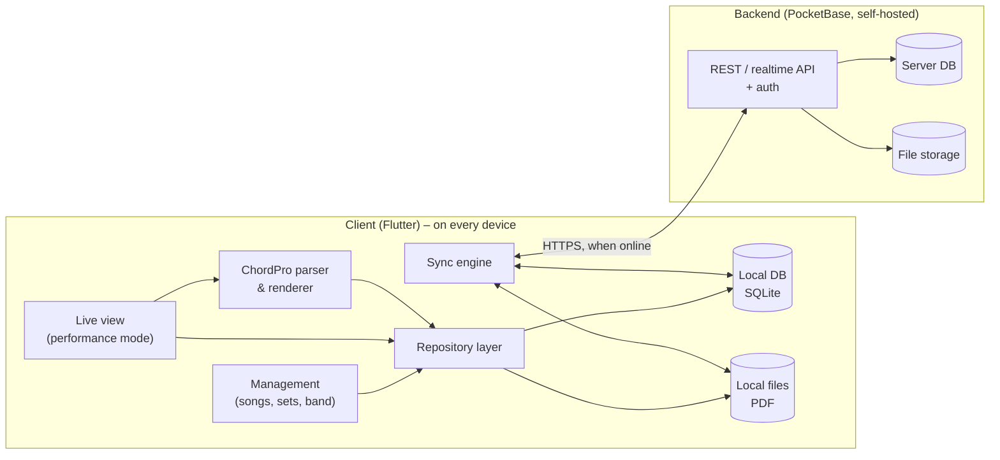
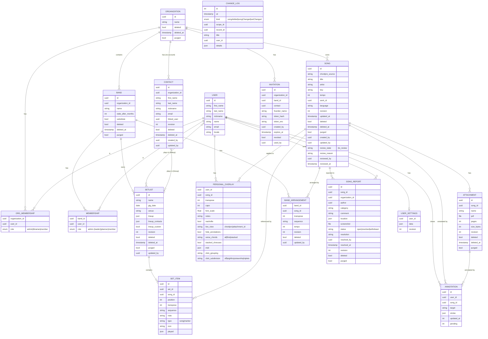

# setDING – Architecture

> Status: **Draft for discussion** (most core decisions accepted) · Last updated: 2026-11-23
>
> This document describes the overall architecture. Individual decisions are recorded
> as Architecture Decision Records (ADRs) in [`adr/`](adr/).

## 1. Goal and context

setDING (called RealChord until 2026-11-17, working title until 2026-11-15: BandChords) is an app that lets bands see the chords of their songs on tablets
(Android, iOS, Windows) while performing – similar to SongBook Pro, but focused on
**sets that are managed together** within a band.

- Songs are stored in **ChordPro format**; PDF sheet music can be attached.
- A responsible person (e.g. the band leader) **creates sets** and adds songs to them.
- All band members **see the sets** on their own device and play from them live.
- The user interface is available in **German and English**, selectable in the settings.

### Actors

| Role | Responsibilities |
|---|---|
| **Organization admin** | Manage the organization (e.g. a music school or a church with several bands): invite people, create bands, manage all its bands and its song library; may do everything |
| **Librarian** *(organization)* | Create, import, edit and delete the organization's songs and attachments |
| **Band leader** (stored as band `admin`) | Manage the band, add organization members to it, invite people into it, put sets together, create new songs and edit their own. A band can have several leaders. |
| **Set planner** *(band)* | Create, edit, reorder and delete the band's sets |
| **Member** | View sets and use them live, personal adjustments (transposition, notes, font size) |

A user can be a member of several organizations and bands; roles are defined per organization and per band (ADR-0005, ADR-0017). ADR-0023 (accepted) refines them: organization roles admin > librarian > member, band roles leader (`admin`) > set planner > member; organization admins keep all rights. The bands of an organization share its song library; nothing is shared across organizations, and users only see the people of their own organizations.

## 2. Quality goals (prioritized)

1. **Reliability on stage** – The app must work without a network. No loading, no login, no crash during a performance.
2. **Readability and live usability** – Large, legible display, page turns via tap, swipe, Bluetooth page turner or keyboard, screen stays on.
3. **Easy management** – A set can be put together in a few minutes and is available to all members.
4. **Platform independence** – One code base for Android, iOS and Windows.
5. **Open data format** – ChordPro files can always be imported and exported, no lock-in.

## 3. Solution strategy (overview)

| Topic | Approach | ADR |
|---|---|---|
| Operating mode | **Offline-first**: local database and PDF files on every device, sync when a network is available | [ADR-0001](adr/0001-offline-first.md) |
| Client technology | **Flutter** (one code base for Android, iOS, Windows; optionally web/macOS) | [ADR-0002](adr/0002-client-flutter.md) |
| Data format | **ChordPro as the source of truth**, parsing and rendering in the client; display notation B/H selectable, Nashville numbers | [ADR-0003](adr/0003-chordpro-source-format.md) |
| Backend & sync | **PocketBase**, self-hosted on an existing server, revision-based sync | [ADR-0004](adr/0004-backend-and-sync.md) |
| Management | **One app with roles** instead of a separate management application | [ADR-0005](adr/0005-single-app-with-roles.md) |
| Personal settings | **Overlay model**: personal adjustments never change the shared ChordPro text (e.g. key, capo, Nashville, chords in the first verse only, verses or choruses stacked line by line); a personal setting shows a chorus written out again only once (ADR-0058); per user (`local` for the local library), synced with the account | [ADR-0006](adr/0006-personal-overlays.md), [ADR-0020](adr/0020-overlays-per-user.md), [ADR-0040](adr/0040-stacked-verses.md), [ADR-0058](adr/0058-written-out-chorus-once.md) |
| Freehand annotations | Personal pen, highlighter, text and stamp marks, drawn in live mode on ChordPro and PDF pages; stored in **page coordinates** with a layout fingerprint (exact on the stage device, free arrows possible) and a **line anchor** as fallback for other layouts; PDF strokes per page; per song, private, synced as one record per person, song and target, **merged per stroke** on the server; editable with eraser, lasso and undo; band annotations later | [ADR-0032](adr/0032-freehand-annotations.md) |
| Settings sync | Settings split into **personal** (instrument and bass strings, voice, notation, chord style, display, theme, language, drummer preferences; synced with the account, last writer wins per key) and **device** (font size, columns, live appearance, server, sync mode, click volume and latency; never synced); fixed per setting and shown in the settings | [ADR-0027](adr/0027-personal-settings-sync.md) |
| Keyboard programs per profile | **One keyboard program per device profile** and song: changing keyboards needs no change of the songs; new field `overlays.midi_programs`, `overlays.midi` kept for v0.16.0 clients; Yamaha Motif XF profile | [ADR-0042](adr/0042-keyboard-programs-per-profile.md) |
| Backup & trash | **Backup archive** of a whole library (ZIP with `manifest.json`, ChordPro files and attachments) exported by the client on native and web, for organizations by org admins and librarians after a **mandatory sync**; import always **as a copy** with new IDs, identical songs reused. **Full backup** in the settings (format version 2): all libraries the person may back up, their own adjustments of the other organizations and their settings; a reminder for the local library after 30 days. **Set archive** (#707): the set ZIP has a `manifest.json` and is imported again as a set, with export options, a preview, existing arrangements kept and the choice to replace a re-imported set. **Song archive** (#792): one or several songs with their attachments as a ZIP with a `manifest.json`, imported again with a preview like a set; missing attachments of existing songs are added. **Trash**: deleted songs and sets restorable for 30 days or deleted permanently before (by whoever may delete them, synced as `purged`, #866), then purged on the server with a tombstone kept | [ADR-0043](adr/0043-backup-archive-and-trash.md) |
| Local library backup | Optional **automatic backup of the local library** (device setting, native apps) into a folder chosen through the operating system (cloud storage through document providers or desktop sync clients, no provider APIs; own platform code for Android SAF and iOS bookmarks), at most daily after changes, the newest 1 to 10 per device kept (a setting, default 10); a backup of a local library can be restored by **replacing the whole local library** with the original IDs after a skippable safety backup (into the automatic backup folder or a chosen place); a device setting hides the local library when signed in, also when not empty (it filters the lists of libraries and bands; backups still include it); no sync through WebDAV, Dropbox or OneDrive | [ADR-0054](adr/0054-local-library-automatic-backup.md) |
| Deleting bands, closing organizations | **Organization admins** delete a band or close the organization with `DELETE` on the records API; the server turns it into a **soft delete with a cascade** (sets, arrangements, memberships; for an organization also songs and attachments), refuses writes into deleted parents and keeps both **30 days in the trash** (ADR-0043); a closed organization is then **purged for good**, leaving a tombstone without a name; restore by `PATCH {"deleted": false}` | [ADR-0044](adr/0044-delete-bands-close-organizations.md) |
| Deleting the own account | Any user deletes **their own account** with `DELETE` on `users` and the **password** in the body; refused while they are the **last admin** of an organization; memberships are **soft-deleted** (tombstones without a person), private data removed, references cleared without new revisions; shared content stays; immediate and final (backups 14 days) | [ADR-0052](adr/0052-delete-own-account.md) |
| Start screen | A first tab **Overview** (*Übersicht*) before *Sets · Songs · Settings* (on tablets and desktops *Settings* pinned to the bottom of the navigation rail, #937): the **next set** with *Start live* on top, **Ready to play** (whether this device is ready for the gig: musician, MIDI keyboard, next set offline, sync, page turner, automatic backup, each line leading to its setting, #911) and the **more sets** after it, a *To do* card for people who may edit songs (ChordPro problems, possible conversions, sync conflicts, sheet music only), **recent changes** by others since the overview was last shown on this device (new and changed songs, a PDF counts as a change of its song; sets with songs added or removed or changed sequences) from a local change log the sync engine fills, the **newest songs** of the band's library (`songs.created_at`, #868), the songs **not played for a while** (repertoire, ADR-0046), the version with the update hint and *What's new* in the footer; after a sync, a hint on the open song or set changed or deleted by someone else, and one summary after live mode (#691); local data only, nothing new on the server | [ADR-0045](adr/0045-overview-start-screen.md) |
| MIDI program change | In live mode the **personal keyboard program** of the current song (raw bank select and program change in the personal overlay, own server field `overlays.midi`) is sent to one keyboard over **USB** once the song stayed current for about 300 ms (also when it equals the previous program); device profiles (Nord Stage 3 with programs or Nord songs, Yamaha Motif XF with voices and performances and an automatic mode change by SysEx, generic), output and channel are device settings, offered and used only while the musician's instrument is keyboard; a "Test" button sends a song's program on request; a prototype on all platforms with a real Nord comes first; Android, Windows, Linux and web (Chrome/Edge), iOS with the iOS app | [ADR-0039](adr/0039-midi-program-change.md) |
| Band arrangements | New layer between song and set item: per band and song a key (transposition), sequence and tempo, maintained by band leaders and set planners, synced per band with last writer wins; set item transposition becomes relative to the band's key | [ADR-0025](adr/0025-band-arrangements.md) |
| Language versions | Translations and free adaptations of a song are linked by a shared **group ID on the song** (`songs.work_id`), all versions equal (no original), only within one organization; a **language per song** detected on the device from word lists (a suggestion, empty when unsure, not synced) or set by hand (`songs.language`, synced, always wins); language tags and a language filter in the song list, the versions in the song view header; linked by hand by whoever may edit the song; a set item can be switched to another version, then that version's band arrangement applies; adjustments stay per version with an offer to copy them; the group is kept within song and backup archives | [ADR-0053](adr/0053-language-versions.md) |
| Song play history | A song in a past set (gig date before today) counts as **played**; the resolved key, tempo and sequence are **frozen in the set item** (`played`) on the gig day by the first client with set rights; v1 card *Played* in the song view and hints in the set editor, v2 band repertoire in the Sets tab (most played, not played for a while after a threshold per band, never played), v3 plays of other bands for all organization members through a server route, stored at sync for offline use | [ADR-0046](adr/0046-song-play-history.md) |
| Set markers | Non-song entries of a set are added with one command *Add marker*: an **icon from a curated catalogue** (stable keys, a translated default name each) and a text of at most 24 characters prefilled with the icon's name that can be overwritten; **no break or text type any more**; **every marker is a divider** in the printable set list and the text export; an unchanged default name is stored empty and shows in each member's language; `type` is written only for older apps; stored as `icon` in the set item JSON, kept by the server for older apps | [ADR-0047](adr/0047-set-markers-with-icons.md) |
| Keyboard shortcuts | **Esc goes back** on every screen when nothing else handles it (dialogs, menus, own Esc keep it; `PopScope` respected); per-screen single-key shortcuts (`PageShortcuts`) only while the screen is current and visible and **no text field has the focus**: **E** edit, **L** live, **+/−** personal transposition, **←/→** previous/next song of the set, **/** or Ctrl+F search; **?** lists all shortcuts | [ADR-0049](adr/0049-keyboard-shortcuts.md) |
| Settings layout | Every settings category is a list of **titled sections separated by dividers**, and **every option has a leading icon** (shared `SettingsSwitch` / `SettingsChoice` require it); the synced/device note is a tonal banner; the content uses the width of its pane, in two columns of sections from 1040 (the song display in one, for its preview); a widget test fails on an option without an icon or outside a section | [ADR-0050](adr/0050-settings-screen-layout.md) |
| UI design rules | App-wide **design rules** for the management screens ([guide](../development/ui-design.md)), the base under the settings layout of ADR-0050: colours only from the scheme or `StatusColors`, spacing in steps of 4, width limits on large screens, and **shared widgets** for section headers (`SectionHeader`, also under `SettingsSection`), confirmations (`confirm`, destructive by default with an error-coloured button), danger zones (`DangerZone`, a red-tinted tile at the end of a screen), messages (`showMessage…`, replace the one shown, hints with an action go away by themselves) and states (`AsyncBody`, `EmptyState`); checkable rules enforced by `app/test/ui_rules_test.dart`; live mode and the song renderer keep their own theme | [ADR-0051](adr/0051-ui-design-rules.md) |
| Drummer mode | Drums instrument preset; beat display and count-in in live mode; **click on the in-ear** from a looped one-bar audio buffer (`flutter_soloud`, the audio is the clock), latency compensation; automatic or manual start, long press of the forward pedal or Enter (or Space, a device setting, #969); tempo on stage only for the evening; song map layout for drums, below the wide layout (phones, tablets in portrait) the beat with the set or the song map (#952, #974); grouping and subdivisions of the click per song in the personal overlay (#698) | [ADR-0026](adr/0026-drummer-mode.md) |
| Live mode | Page turns by tap, swipe, Bluetooth page turner or keyboard, wakelock (set again on return to the app, a failure is shown), next song prepared ahead in idle time (no work in the frames of a turn), progress bar of the set with the pages of the current song (hold and drag on it to jump to a song), stage appearance (dark/black) independent of the app theme, parts outside the song sequence dimmed or (personal setting) hidden; each member navigates independently (**no leader sync**); the sync is paused while live, one hint sums up the changes of others afterwards | [ADR-0007](adr/0007-live-mode.md) |
| Localization | UI in **German (Swiss, `de-CH`), English, French, Italian, Spanish and Portuguese**, selectable in the settings | [ADR-0008](adr/0008-localization.md) |
| Sheet music | **PDF attachments** per song, synced and available offline, shown in live mode | [ADR-0009](adr/0009-pdf-attachments.md) |
| Chord display style | Suffix parsed into quality, extension and alterations; **device setting** *As written* / *Standard* / *Jazz* plus optional superscript, combinable with B/H and Nashville; source unchanged | [ADR-0022](adr/0022-chord-display-style.md) |
| Roman numerals | The Nashville switch becomes a **chord view** *Chords* / *Nashville* / *Numerals* (device setting, per-song overlay, live toggle); numerals computed from chords and key, case shows the quality (`vi7`, `viiø7`, `V7`), minor keys counted from the parallel major (`i – ♭III – ♭VII`), slash chords as `I/3`, fixed jazz spelling, no `V/V`; explained on its own website page; a second spelling *upper case with chord symbol* (`IIm7 – V7 – Imaj7`) that follows the chord style | [ADR-0055](adr/0055-roman-numeral-chords.md), [ADR-0059](adr/0059-numeral-spelling.md) |
| Key suggestion | Songs without `{key}` get a **key guessed from the chords** in the song details (best key and, when close, the runner-up), written only after a person picks it and taps *OK*; never a conversion and never an implicit key for the chord views; a *To do* line and song list filter *No key*; the import report suggests keys for imported songs without one, a tap per song | [ADR-0056](adr/0056-key-suggestion-from-chords.md) |
| Page turner pairing | The page turner is paired by a key press in *Settings › Live* (name, vendor and product ID, a device setting, never synced; matched by the IDs, the name only without them); one platform channel `app.setding/input_devices` lists the connected keyboards and names the device of every key (Android `InputManager`, Windows Raw Input), iOS only tells whether a keyboard is connected (`GCKeyboard`); the overview's *Ready to play* warns when the paired page turner is not connected; a device setting *I use a page turner* and an offer on the overview to pair a page turner pressed there (#930) | [ADR-0057](adr/0057-page-turner-pairing.md) |
| Song display styles | Personal **Song display** settings: Standard style plus seven fixed section types (intro, verse, pre-chorus, chorus, bridge, interlude, outro) derived from the section name or the label of a verse, each with its own style or **inheriting from a chosen type**; chords, lyrics, heading, indent bar and tint; a font choice (standard or monospace) for the whole song; curated palette with light and dark tones; presets; explicit colours beat song directives, inline markup always wins; live mode and song view, not the editor preview | [ADR-0033](adr/0033-song-display-styles.md) |
| ChordPro coverage | **Whole specification** (transpose, grids, markup, conditionals, diagrams, images, delegated environments; ABC and a Lilypond lead-sheet subset drawn by setDING's own engraver) | [ADR-0012](adr/0012-full-chordpro-support.md) |
| SongSelect (CCLI) | **No API integration** (partner program closed); manual import of ChordPro files downloaded from SongSelect | [ADR-0011](adr/0011-songselect-import.md) |
| Server hosting | **Production on a VPS** (Infomaniak VPS Lite, Debian 13) and a **test server** on the owner's Proxmox LXC (`setding.dev`), both running the **published server bundle** with systemd in the layout of the self-hosting docs, published via **Cloudflare Tunnel**, built-in backups plus a backup before every update; `make server-release` installs a release's bundle on production, `make server-install` the working tree on the test server (`SERVER_PROD`, `SERVER_STAGING`, `TARGET`); the website separately on `SERVER_SITE` | [ADR-0014](adr/0014-server-hosting.md) |
| Self-hosting distribution | Per release a **server bundle** (PocketBase, hooks, migrations, web client) and a multi-arch **Docker image on distroless**, both supported (bundle natively with systemd or the image); no installer, no reverse proxy, no compose file or systemd unit in the package (proxy requirements, examples and Caddy in a website chapter); both tested automatically in `make check` and the release workflow before publishing; the owner's production (VPS) and staging (LXC) run the published bundle natively; website independent of the backend | [ADR-0063](adr/0063-self-hosting-distribution.md) |
| Sign-in & session | Email/password via `SyncBackend` (PocketBase SDK, pinned), session in secure storage, kept while offline, refreshed when online, 30-day tokens | [ADR-0016](adr/0016-client-authentication.md) |
| Update check | Installed release builds ask their server (`latestClientVersion` in `/api/setding/config`) 5 s after the start, at most daily; a **dot** on the settings, a tile under *Storage & info* and **one SnackBar per version**, never in live mode, no dialog; Google Play installs are pointed to Google Play (ADR-0067) | [ADR-0036](adr/0036-update-check.md) |
| What's new | Bundled **bilingual notes per version** (`app/assets/whats_new.json`, written in the release PR, enforced by `make check`); after an update **one SnackBar** with a dialog of the notes of the new version only (#773), nothing on a new installation, never in live mode; always via a button next to the version under *Storage & info*; the website shows the same notes on a news page and the current version in its header | [ADR-0041](adr/0041-whats-new-after-update.md) |
| Windows TLS trust | The Windows client trusts the system roots **plus the bundled ISRG roots X1/X2** (Let's Encrypt), since Windows adds missing roots only on demand and Dart does not trigger that | [ADR-0034](adr/0034-bundled-root-certificates.md) |
| Registration | Server operator sets `SETDING_REGISTRATION` = `invite_only` (default: sign-up only with an invitation, new organizations only via operator **founder invitations**) or `open`, and `SETDING_EMAIL_VERIFICATION` = `off` (default) or `required` (needs SMTP); no in-app super-admin; rate limits on sign-up and invitations | [ADR-0024](adr/0024-registration-mode.md) |
| Organizations | Bands belong to an **organization** that owns the shared song library; organization admins manage people and bands; created automatically for a single band | [ADR-0017](adr/0017-organizations.md) |
| Finer-grained roles | Ordered fixed roles: organization admin > **librarian** > member, band leader > **set planner** > member; organization admins may do everything; librarians edit the library (replaces `members_can_edit_songs`), band leaders create new songs and edit only their own; leaders may invite into their band | [ADR-0023](adr/0023-finer-grained-roles.md) |
| Song review & reports | A **review status** per song (*to review* with a reason / approved), set by file imports ("After import") and approved explicitly by whoever may edit the song; **mistake reports** by anyone in the organization in their own collection (category, comment, location, optional **screenshot with own markings**, PNG), resolved with an answer and kept as history; review fields last writer wins without a base revision; a discreet icon for everyone, *To do* only for approvers | [ADR-0060](adr/0060-song-review-and-reports.md) |
| Set lineup & substitutes | A **lineup per set** (people, no roles): the whole band by default, band members unchecked or **people of the organization added** as substitutes; a band member taken out still sees the set as *not planned for you*; a substitute sees only the sets they are in the lineup of, read-only, with the band arrangements of their songs, through a server route replaced at every sync; *Notify lineup* shares a prepared text from the device with the lineup's mail addresses filled in (a server route, only for people who may edit the set), plus a hint in the app; no server mail; the lineup in the header of the printable set list | [ADR-0061](adr/0061-set-lineup-and-substitutes.md) |
| People without an account in the lineup | **Contacts of the organization** (first name, optional last name, nickname, optional mail address) put in a set's lineup next to its people (`setlists.lineup_contacts`), reused in every band; created and edited by set editors from the lineup dialog, deleted by organization admins only (soft, mail address cleared, old sets keep the name); mail addresses only for set editors and *Notify lineup*; a **personal invitation** for a contact (by mail from the device, link or QR code, single-use, sign-up prefilled from the contact) links it to the new account in every lineup when redeemed | [ADR-0064](adr/0064-lineup-people-without-account.md) |
| URL routing & deep links | **`go_router`**: every screen a route with a path by record id (`/sets/<id>`, `/songs/<id>`, …), the main tabs a `StatefulShellRoute`, dialogs and panels stay imperative; on web path URLs, so the browser's back and forward buttons follow the app and a reload keeps the screen (the server serves `index.html` for app paths); **share links** `<SETDING_WEB_URL>/sets/<id>` open the installed app (App Links, Universal Links, `setding://` on desktops) or the web client; opening a link switches to the record's band, a record not on the device shows *Not available* | [ADR-0065](adr/0065-url-routing-and-deep-links.md) |
| Person names | Accounts have a required **first and last name** and an optional **nickname**; the server keeps `name` as the display name for older apps and splits names of older apps and of existing accounts; the app asks old accounts for the missing parts; *Show names as* is a personal setting (nickname, First Last, Last First, First Last (nickname)); people are searched by every part | [ADR-0062](adr/0062-person-names.md) |
| Lyrics projection | Live mode starts a **local web server in the native app** (`dart:io`, off by default, not on web) that serves one page with the **lyrics without chords** as slides per section in the played order, pushed with Server-Sent Events; follows live mode, a song turns manual once advanced by hand; optional second language side by side, a lower-third page for livestreams; read-only, only the current projection, random token in the URL shown as a QR code, private addresses only; *Blank*, markers as blank or text slides, `{copyright}` on the slides (no CCLI fields); projection settings are device settings | [ADR-0068](adr/0068-lyrics-projection-local-server.md) |
| Server data model | PocketBase collections as migrations, server-wide revision counter, set items as JSON, access rules per role, tested against a real PocketBase | [ADR-0015](adr/0015-server-data-model.md) |
| Printable set list | PDF generated in the client with the `pdf` package, embedded font, saved via the save dialog; no print plugin yet | [ADR-0013](adr/0013-printable-set-list.md) |
| Opening exported PDFs | The message after a PDF export offers **Open**: a copy in the app's cache is opened in the system's default app with `open_filex` (FileProvider on Android, its media permissions removed); PDF exports only | [ADR-0048](adr/0048-open-exported-pdf.md) |
| Web client | **Flutter web build of the same app** for management without installation, served by PocketBase (`pb_public`) at `app.setding.app`, same sync engine, sign-in required, ChordPro file import, export as a download, no offline guarantee in the browser ([guide](../development/web.md)) | [ADR-0018](adr/0018-web-client.md) |
| Website & user docs | **Astro Starlight** in `website/` (de-CH root, en under `/en/`), landing page and user documentation at `setding.app`, built in `make check` with link validation, served by **Caddy** on the owner's server behind the tunnel, deployed on its own with `make server-site`, independent of the backend (ADR-0063) | [ADR-0030](adr/0030-website-and-user-docs.md) |
| GitHub organization | The repository belongs to the GitHub organization **`setDING`** (`github.com/setDING/setDING`, transferred from `tafli/setDING`, which GitHub redirects and which must never be created again); the server image is `ghcr.io/setding/setding-server`; the website stays in this repository, so a feature, its page and its screenshot land in one PR | [ADR-0066](adr/0066-github-organization.md) |
| Google Play | Google Play becomes the recommended Android channel **next to** the Obtainium APK (same application ID); Play App Signing with the **existing release key**, so both channels update each other and App Links keep one fingerprint; the release workflow uploads an AAB signed with an upload key through the Play Developer API to the **internal track**, promotion by the owner; Play installs get an update hint pointing to Google Play | [ADR-0067](adr/0067-google-play-distribution.md) |
| Linux release | `make release`: Linux release built in a **Debian container** (baseline glibc, ISA check) from the committed state ([guide](../development/releases.md)) | [ADR-0019](adr/0019-linux-release-builds.md) |
| Linux AppImage | The release build also packs the bundle as an **AppImage** (appimagetool and type-2 runtime pinned by checksum) next to the tar.gz; the AppImage takes the newer version from the update check (ADR-0036) and, after a tap on *Install*, downloads the new AppImage, checks it against `SHA256SUMS`, replaces its own file in one step and restarts; on request it adds itself with its icon to the desktop's application menu (*Storage & info*), and the entry follows a moved AppImage and opens `setding://` invitation links (single-instance app, #1015) | [ADR-0038](adr/0038-linux-appimage-self-update.md) |
| Release builds | A `vX.Y.Z` tag builds **Linux, Android and Windows** on GitHub Actions and publishes a GitHub Release; Android APK (arm64 only) signed with a stable release key (repository secrets), installed and updated with **Obtainium**; build number = the workflow's run number, shared by releases and manual test builds (none in `pubspec.yaml`); release notes are the version's section of **`CHANGELOG.md`** (Keep a Changelog), written in the release PR; a release is done when its build passed and the server is deployed from the tag ([guide](../development/releases.md)) | [ADR-0021](adr/0021-release-builds-github-actions.md) |
| Windows distribution | **Inno Setup installer** (per user, no admin rights) next to the zip; the installed app takes the newer version from the update check (ADR-0036) and, after a tap on *Install*, downloads the setup from the GitHub release, checks it against `SHA256SUMS` and installs it silently; no code signing (SmartScreen warns once at the first install) | [ADR-0035](adr/0035-windows-installer-self-update.md) |
| SBOM | One **CycloneDX** SBOM per release asset (`<asset>.cdx.json`), generated by the own Dart tool `tool/sbom` and listing only what the asset ships (compiled Dart packages, bundled assets, plugins and native libraries of the platform, Gradle release classpath via the CycloneDX Gradle plugin, Flutter, Windows runtime and installer, AppImage runtime); validated with cyclonedx-cli; `metadata.component` names `setDING` with the tag version, the asset's SHA-256, platform, build and commit; the release fails if name, version or hash do not match; vulnerabilities and licences are evaluated on GitHub (Dependabot, dependency review); the server bundles get one too (PocketBase with its Go modules, the web client), the server image an SBOM attested on ghcr.io | [ADR-0037](adr/0037-sbom-cyclonedx.md) |
| Versioning | **Semantic Versioning** for the whole product (apps, web client, server): major = old clients no longer work with the server or data (all devices must update), minor = features old clients tolerate, patch = fixes; before 1.0.0 minor also covers incompatible changes; CalVer considered and not chosen ([guide](../development/releases.md)) | [ADR-0028](adr/0028-versioning-scheme.md) |
| Minimum client version | Clients send `X-Setding-Version`; the server refuses versions below `MIN_CLIENT_VERSION` (in the hooks, raised with an incompatible change) with **HTTP 426**; the app shows "Please update setDING" above the navigation and on the sign-in screen, keeps the session and local changes, stops the automatic sync; release before deploying the server | [ADR-0029](adr/0029-minimum-client-version.md) |

## 4. Building block view

### Client modules

| Module | Responsibility |
|---|---|
| `chordpro` | Parser (ChordPro → AST), chord model (incl. structured suffix, ADR-0022), transposition, Nashville and Roman numeral conversion (ADR-0055), key suggestion from the chords (ADR-0056), metadata extraction. Pure Dart package without UI dependencies, easy to test. |
| `render` | Rendering the AST: chords above lyrics, sections (verse/chorus), one or more columns, auto-fit with song pages in live mode, notation B/H, Nashville numbers, chord style with raised extensions (ADR-0022), song display styles per section type (ADR-0033) |
| `pdf` | Displaying PDF attachments (fit to width/page, two-page view) |
| `data` | Local DB (SQLite, e.g. via `drift`), repositories, domain model |
| `sync` | Sync between local DB and backend, conflict handling, offline queue. `SyncEngine` runs the order of a sync; the parts per kind of record live in `app/lib/sync/engine/` (songs with conflicts, sets, attachments with downloads, personal adjustments, shared cursors and outbox, and `ChangeRecorder`, which fills the change log of the overview while records are applied and reports the changes of others per run for the hints on the open screens, ADR-0045) |
| `overview` | The start screen (ADR-0045): the first tab of the main navigation (`HomeTab`, `homeTabProvider`, `app/lib/ui/home_tab.dart`) with the cards *Next set* (*Start live* on the first song, *Open set* or a tap on the card; otherwise the most recently edited set) and *To do* (songs with ChordPro problems, possible conversions, sync conflicts and sheet music only that the person may edit, each line switching to the song list filtered to those songs, `SongAttention` in `app/lib/ui/songs/song_attention.dart`), *Recent changes* (the change log of `app/lib/data/change_log.dart` since the device setting "last shown", at most ten, with *Show all*, `recent_changes.dart`), *Ready to play* (`readiness.dart`: one check per line with a level and the settings category it opens through `settingsJumpProvider`; the page turner's last use and, when paired, its connection from `app/lib/ui/live/page_turner.dart`, #911, ADR-0057), *More sets* (the upcoming sets after the next one), *Newest songs* (`watchNewestSongs`, by `songs.created_at`) and *Not played for a while* (the band's repertoire, with *Show all* opening it) (#868), and the footer with version, update hint and *What's new* (shared with *Storage & info*, `app/lib/ui/widgets/app_info.dart`); one column on phones, two from 720 px (`app/lib/ui/overview/`) |
| `live` | Performance mode: full screen, wakelock, page turns by tap, swipe, page turner or keyboard, set navigation; beat display, count-in, tempo on stage and song map of the drummer mode (ADR-0026); sends the keyboard program of the current song with `LiveMidiSender` (`lib/midi/live_midi_sender.dart`), shows the MIDI indicator; the keyboard symbol sends the program again on a long press and opens the program sheet (`live_midi_sheet.dart`: send again, change with preview, same as previous song, remove, #607; take over what the keyboard sends while it is open, #608) (ADR-0039) |
| `audio` | Click of the drummer mode: one bar rendered as WAV and looped by SoLoud on its engine clock, beat timeline, latency calibration (ADR-0026) |
| `manage` | Create/import songs, ChordPro editor with syntax highlighting, a form for the main metadata (title, key, tempo, …), line numbers (tap to select lines), bracket matching, autocompletion, moving lines and chords (also by mouse drag and drop), line tools and undo/redo buttons, search and replace with highlighted matches, converting chords-above-lyrics text, coloured section backgrounds, tap in the preview to jump to the source, a warning on save for invalid ChordPro and preview, put sets together |
| `annotations` | Personal freehand annotations (ADR-0032): placement in place or at the anchor line, the layer that paints and takes stylus input, drawing mode state (tools, selection, undo/redo) and its toolbar (`app/lib/ui/annotations/`) |
| `band` | Login, band selection, invitations, roles |
| `midi` | MIDI to a keyboard (ADR-0039): `MidiOutput` on `flutter_midi_command` (USB MIDI on Android, Windows, Linux; Web MIDI), program change bytes and the Nord Stage 3 addressing; device profiles `MidiProfile` (Nord Stage 3, Yamaha Motif XF, generic) that translate raw values to the musician's terms and back and may precede the bank select with bytes of their own (the Motif XF mode change, #591); `MidiConnection` (`midiConnectionProvider`) keeps the output of the device settings connected from app start, reconnects when it is plugged in again and sends a `MidiProgram` on the configured channel (#562); the song's personal adjustments panel has the *Keyboard program* field with a picker in the profile's terms and a "Test" button (`lib/ui/songs/midi_program_field.dart`, #563), plus the programs of other keyboards (profiles) and *Program for another keyboard* (ADR-0042, #593), all as one *profile: program* list under "This device: <profile>" (#597) with short program labels (#599); the MIDI test screen of the prototype stays as a diagnostic (#512) (`lib/midi/`) |
| `projection` | Lyrics projection (ADR-0068): `ProjectionServer` (`dart:io`, native only, a stub on web) serves the projected page and a Server-Sent Events stream of the `ProjectionState` under `/p/<token>`, to private addresses only, 404 for everything else; the slides come from `lyricSections` / `lyricSlides` of the chordpro package |
| `update` | Updates of the Windows app installed with the setup (ADR-0035) and of the Linux AppImage (ADR-0038): takes the version from the update check (ADR-0036), downloads the setup or AppImage of that release, verifies it against `SHA256SUMS`, then runs the setup silently or replaces the AppImage (`lib/update/`, `lib/platform/self_update_io.dart`); the application menu entry of the AppImage (#1006, `lib/update/app_menu_entry.dart`, `lib/platform/app_menu_entry_io.dart`); the "What's new" notes after an update (ADR-0041, `lib/update/whats_new.dart`) |
| `l10n` | UI translations (German, English) and language setting |

## 5. Domain model (draft)

Notes:

- **`SONG.chordpro_source`** is the single source of truth. `title`, `artist`, `key` and `tempo` are extracted from the ChordPro directives (`{title}`, `{artist}`, `{key}`, `{tempo}`) on save and stored redundantly only for search and sorting; likewise the raw song sequence (`{x_sequence}`, `songs.sequence`, schema 13) so that the song list can show it without loading the ChordPro text. Song sources (recordings on YouTube, Spotify, …) are `{x_link: URL | Label}` directives in the ChordPro text, shown in a side panel of the song view (ADR-0012, #469). On the device, a full-text index (SQLite FTS5) covers title, artist and the lyrics without chords (`songs.search_text`); the search matches the beginnings of words, ignoring accents. The song list highlights the hits in title and artist and shows a snippet of the lyrics around a hit; both come from the index itself (FTS5 `highlight()` / `snippet()`), so highlighting follows the same rules as the search. The song list can be sorted by title, artist, key (C to B, major before minor) or last edit, chosen with a chip at the start of the filter row and stored per device; title and artist (`{sorttitle}` / `{sortartist}` first) are compared ignoring case and accents, with section headers for the first letter, the artist or the key. From 900 px width (tablets in landscape, desktop) the list has two columns; section headers span both, and a song still opens full-screen. Small status icons at the end of each song show an open sync conflict, the next set of the current band with a gig date from today on, and songs with sheet music (PDF) only, i.e. without ChordPro text. For people who may edit the song, a warning icon marks songs whose ChordPro probably does not show as intended (`validateChordPro`); the count is derived on the device (`songs.chordpro_problems`, schema 14, not synced), and the import, the song, sets and the set overview report it too (ADR-0003, #314). Likewise, a magic wand icon marks songs with places the editor offers to convert (SongSelect directives, the CCLI footer, CCLI bar lines, short-form section labels, comment headings, German section labels, which become English (ADR-0008, #1085); `countChordProConversions`, `songs.chordpro_conversions`, schema 30, recounted in schema 41, not synced); apart from the German labels they show as intended, and the song list filtered to them converts all at once (#798); a tap on the wand converts one song, with Undo, and the *To do* filters are also chips of the song list (#800).
- **`SETLIST.lineup`** (ADR-0061) holds the people who play a set when `lineup_custom` is true; otherwise the lineup is the whole band and nothing is stored. Only people of the band's organization can be added (hook); a deleted account leaves every lineup without a new revision, a purged set clears it. Substitutes (people in a lineup who do not see the band's sets through the records API) get their sets, the lineups' names and the band arrangements of those songs from `GET /api/setding/lineup`; set editors get the lineup's mail addresses from `GET /api/setding/lineup/{set}/emails`. On the device (schema 38) a set keeps `lineup` and `lineup_custom`; the bands of substitute sets are stored with **`BAND.substitute`** (device only, not synced) and their sets and arrangements are replaced by every full sync from the lineup route, never pushed. A set counts as the user's gig (overview *Next set*, the song list's upcoming-gig icon) when they are in its lineup, or, without one, when they are a band member.
- **`CONTACT`** (ADR-0064) is a person without a setDING account in the organization, put in lineups through **`SETLIST.lineup_contacts`** next to `lineup`; only the organization's contacts that are not deleted can be added (hook). Every member sees the names; the mail address only people who may edit sets in some band of the organization (enrich hook) and *Notify lineup*. A personal invitation (`INVITATION.contact`, single-use) links a contact when it is redeemed: the server replaces it with the new member in every lineup of the organization and marks it deleted (`linked_user`). On the device (schema 42) contacts are a table per organization synced like the other records (the mail address null for everybody but set editors), and a set keeps `lineup_contacts`.
- **`USER.first_name`, `last_name`, `nickname`** (ADR-0062): first and last name are required on sign-up and cannot be cleared (hook, not `required` in the schema, so old accounts stay valid until completed); **`USER.name`** is maintained by the server as the display name (nickname, otherwise "First Last") for older apps and server routes. The device caches the three fields per organization and band membership (schema 40); the personal setting `nameFormat` chooses how they are shown and sorted.
- **`SETLIST.gig_date`** orders the sets tab in three sections: *Upcoming* (from today on, ascending; the next gig first and highlighted with the days until it), *Without date* (by name) and *Past* (most recent first; collapsed by default, the user's choice to expand or collapse is stored per device; collapsing only hides the cards, a selected past set stays shown next to the list on wide screens and is never expanded automatically). A gig today counts as upcoming, as for the song list's upcoming-gig icon.
- **`SET_ITEM`** allows set-specific adjustments (e.g. one tone lower tonight) and non-song entries (break, announcement, encore separator). **`SET_ITEM.icon`** (ADR-0047) is the key of a marker's icon from the app's catalogue; breaks and texts become one kind of marker (text up to 24 characters, always a divider in the set list), and `type` (`pause`/`text`) is written only for older apps. **`SET_ITEM.played`** (ADR-0046) holds the key, tempo and sequence a song was played with, frozen on the gig day, for the song play history; **`BAND.stale_after_months`** (default 6) is the band's threshold for songs not played for a while. The plays of all bands of an organization (per song and band: count, last date, last frozen key) come from the server route `/api/setding/plays/{organization}` and are kept on the device in `org_plays`, replaced with every sync (ADR-0046).
- **IDs are UUIDs** generated by the client – required for creating records offline without a server.
- **`revision`** and **`deleted`** (soft delete) are the basis for sync (see ADR-0004); `deleted_at` and `purged` (songs, sets, attachments) drive the **trash**: deleted songs and sets can be restored for 30 days or deleted permanently before (#866), deleting a set keeps its items, then the server purges content and files and keeps a tombstone (ADR-0043). Deleting a song, set, set item or attachment can be undone for a few seconds from a message with "Undo"; the restore is a normal change with a new revision, attachment files are deleted only once the undo is gone, and the server restores the adjustments and arrangements a song's deletion removed (ADR-0004, ADR-0015, #267).
- **`ATTACHMENT`** holds PDF sheet music; a song can also consist of attachments only, without ChordPro text (ADR-0009).
- **`PERSONAL_OVERLAY.click_grouping`** and **`click_subdivision`** are the click of the drummer mode for this song (#698, ADR-0026): the grouping of an odd meter (`3+2+2`, the numerator alone for no groups; null = `{x_time_grouping}` of the song) and the subdivisions (null = the personal setting).
- **`SONG.work_id`** links the language versions of a work (translations and free adaptations, all equal) within one organization, and **`SONG.language`** is the language set by hand; the detected language is derived on the device from word lists and not synced (`songs.detected_language`, schema 32, #805; Swiss German from its own words and spellings since schema 39, #1033; tags and a language filter in the song list when the library has songs in more than one language). Both fields sync with the song, last writer wins per field without the ChordPro conflict dialog: each changed field is pushed on its own (outbox `song_links`), and the server checks a song's base revision against `songs.content_revision`, the revision of its last change of anything else (ADR-0053, #804; schema 31).
- **`PERSONAL_OVERLAY.midi_programs`** are the person's keyboard programs for the song **per device profile** (`MidiPrograms`, profile id → raw MIDI values `{msb?, lsb?, program}`, schema 20); the device's profile picks the one shown and sent. On the server it is the separate field `overlays.midi_programs` (ADR-0042). **`PERSONAL_OVERLAY.midi`** is the single program of v0.16.0 clients (schema 19, `overlays.midi`, ADR-0039): kept for them and counted for the device's profile while `midi_programs` was never written.
- **On the server** (ADR-0015) set items are stored as a JSON array in the set (`setlists.items`), so a set is always synced as a whole; an imported set keeps the set it was made from in `setlists.origin` (ADR-0043); attachments carry a redundant `band`; songs store only the ChordPro text and the title (other metadata is derived in the client), plus the language version group, the language set by hand and `content_revision` (ADR-0053); revisions come from one server-wide counter. Collections: `users`, `organizations`, `org_memberships`, `bands`, `memberships`, `songs`, `attachments`, `setlists`, `overlays` (personal adjustments, private per user, ADR-0020; the keyboard programs per profile in their own field `midi_programs`, ADR-0042, the single program of v0.16.0 in `midi`, ADR-0039), `annotations` (freehand annotations, private per user, merged per stroke, ADR-0032), `user_settings` (personal settings, private per user, merged per key, ADR-0027), `invites`, `contacts` (people without an account, ADR-0064).
- **`ANNOTATION`** (ADR-0032) is one personal freehand stroke, stamp or typed text, per song: on a ChordPro song in page coordinates of live mode with the page's layout fingerprint, plus a line anchor (source line, text fingerprint, repeat index) used when the layout differs; on a PDF attachment in normalized page coordinates. On the server the strokes of a person for a song and target are one `annotations` record, merged per stroke ID like `user_settings`.
- **`USER_SETTINGS`** (ADR-0027) holds the personal settings of a user as JSON, private to the user and merged per key; device settings stay on the device.
- **`songs.created_at`** (schema 33, #868) is when the song was created, for *Newest songs* on the overview (ADR-0045): the server's autodate `created` for synced songs, filled by every pull (also for a song the device already has; the upgrade pulls the songs once more from the start), the time of creation on the device for the local library, a copy and a song not pushed yet. Never sent.
- **`updated_by`** is set by the server on every synced record (ADR-0015); the client keeps it for songs (with `created_by`, schema 11, for the edit rights of ADR-0023) and for sets and band arrangements (schema 22, to name who changed them on the overview, ADR-0045). A local change names the signed-in user until the server's answer arrives.
- **`CHANGE_LOG`** (ADR-0045, schema 24) is a device-only table, never synced: the sync engine records the songs and sets other people changed (new or changed song incl. its PDFs, new set, set with songs added or removed or changed sequences) for *Recent changes* on the overview, comparing each record from the server with the local state it replaces. `scope_id` is the organization of a song or the band of a set, `at` the time the change arrived on this device, `details` the counts and song titles as JSON. Nothing is logged on the first sync of a library or band, for the signed-in user's own changes or without a known `updated_by`; entries are kept 30 days. The overview shows the entries after the device setting `overviewLastShown`, one per song or set, only of songs and sets on the device that are not deleted (#701: a deleted song or set drops out, a restored one shows its entries again).
- **`USER.locale`** is optional and no longer used: the language is a personal setting synced with the account (ADR-0008, ADR-0027).
- **Deleting a `USER`** (ADR-0052) soft-deletes their `ORG_MEMBERSHIP` and `MEMBERSHIP` records as tombstones without a person and removes their `PERSONAL_OVERLAY`, `ANNOTATION` and `USER_SETTINGS`; it is refused while the user is the last admin of an organization.

## 6. Key flows

### Preparing and distributing a set

1. The band leader creates a set, adds songs and reorders them via drag & drop.
2. Changes are written to the local DB immediately and synced according to the device's sync setting: at app start (default), automatically, or manually with "Sync now" or by pulling down the list of sets or songs (signed in only, #384). Requests the server rejects for its rate limits are retried after growing waits, so large imports sync completely (ADR-0004, #303).
3. Member devices fetch changes the same way (at start, with "Sync now" or pull to refresh, or in automatic mode on realtime events).
4. A set whose songs or PDF attachments are not all available locally is marked with the number of missing songs; offline ready sets show nothing. Above the sets, a warning says when the last successful sync is more than 24 hours ago or local changes did not reach the server (ADR-0001, #744).

### Joining a band

1. An admin creates an invitation link in the app and shares it (group chat) or shows it as a QR code.
2. The invitee opens the link → the app opens via deep link (or the link is pasted in the app), signs in or registers if needed.
3. The server validates the token and creates the membership with the member role; the band's data is synced to the device.

### Performance

1. A member opens the set → live mode (full screen, screen stays on).
2. Page turns via tap, swipe or a Bluetooth page turner / keyboard (right arrow, down arrow, Page Down, Space forward; left arrow, up arrow, Page Up back; ADR-0007).
3. At the end of a song, "next" automatically moves to the next song in the set.
4. While in live mode, **no** sync operations change what is displayed (changes are applied after leaving live mode, or only announced discreetly).

## 7. Cross-cutting concerns

- **Security:** Authentication via PocketBase (email/password, ADR-0016); data is only accessible within the user's own bands, and write permissions follow the role per band (backend access rules, ADR-0015). The session is kept in the platform's secure storage and stays valid offline, so no new login is needed on stage.
- **Import/export:** Import of `.cho`/`.chordpro`/`.chopro`/`.txt` files (individually and as ZIP, optionally converting German H/B notation; songs with ChordPro problems are reported and can be fixed automatically) and PDF attachments; export of a set as a **set archive** (ZIP with numbered ChordPro files, attachments and a `manifest.json`, with export options) that is imported again as a set with a preview: songs reused or added, existing band arrangements kept unless overwritten, a re-imported set replaced (default) or copied, a copy named "<name> (copy)" when name and date are taken, songs a set planner may not create as text items (ADR-0043, #707); export of one or several songs as a **song archive** with their attachments, imported again with a preview (ADR-0043 §1c, #792); the set list as a printable PDF (ADR-0013), one line per song with title, key for the set and sequence (the text export was removed in #714), opened from the message after the export in the default app (ADR-0048, #721).
- **UI design:** the management screens follow the [UI design rules](../development/ui-design.md) (ADR-0051; settings screen: ADR-0050) and use the shared widgets in `app/lib/ui/widgets/`; live mode has its own stage theme (ADR-0007).
- **Localization:** UI in German, English, French, Italian, Spanish and Portuguese, selectable in the settings (ADR-0008). Song content is not translated; song section names (Verse, Chorus, …) stay English in every language.
- **Settings:** grouped into categories: account & sync and, when signed in, *Organization & bands* (the organizations with their bands, join, new band; what a user may change depends on the role, ADR-0023) on top, then *Personal – on all your devices* (general, musician, display; synced with the account, ADR-0027) and *This device* (screen & live mode, keyboard (MIDI), storage & info; never synced; *Keyboard (MIDI)* has MIDI program changes on/off, the output, the device profile and the channel with hints for the Nord, ADR-0039), each group and category marked with a cloud or device icon and an explanation line. With *Developer mode* (personal, in *General*) a last group *Development* lists *Test features* such as the MIDI test, marked as experimental (#559). Wide screens list the categories on the left and show the selected one next to them; narrow screens open each category as its own page (`app/lib/ui/settings_screen.dart`).
- **Sets:** from 900 px width (the same breakpoint as the song list's two columns) the sets tab shows the list of sets on the left and the selected set (items, actions, offline status) next to it, by default the next gig; the selection is kept outside the widgets, so it survives rotating a tablet. Narrow screens open a set as its own page; songs and live mode always open full screen (`app/lib/ui/sets/sets_screen.dart`).
- **Testability:** `chordpro` package with extensive unit tests (parser, transposition); golden tests for rendering. Integration tests run the real app on an Android emulator or device with `make android-test` (start-up, persistence, secure storage, live mode with PDF, sign-in and sync against a local PocketBase; [guide](../development/android-tests.md)); the web client runs in headless Chrome or Firefox with `make web-test`, served by a local PocketBase like in production (sign-in, drift in OPFS and the IndexedDB fallback, sync, live mode with a fetched PDF, reload, several tabs, "Stay signed in", sign-out; [guide](../development/web-tests.md)). End-to-end tests run the Linux desktop app and the web client at the same time against one local PocketBase with `make e2e`, coordinated through a proxy per client that can also put a client offline (a new song arriving by realtime, an edit on the open song screen, a gig played live, a set reordered by the other person; [guide](../development/e2e-tests.md)). Performance on a real Android device is measured with `make perf` (profile build, timelines of song list, search, live mode and editor; [guide](../development/performance.md), first results in #270). `make coverage` reports the line coverage of the app and the `chordpro` package, including files no test loads ([guide](../development/coverage.md); report only, no threshold). The operations files are tested too: ShellCheck, Caddyfile and systemd units, a backup restore against a real PocketBase and the website server with the real Caddyfile ([guide](../development/operations-tests.md)).
- **Diagnostics:** named loggers (`app/lib/util/log.dart`, no extra package) write to the console (also in release builds) and the Dart developer log, and keep the last 300 messages; the settings copy them to the clipboard for support. Logs contain no song content or credentials.
- **Licence:** the project is MIT-licensed ([`LICENSE`](../../LICENSE)); the code is largely AI-generated. Dependencies and bundled assets must be MIT-compatible (e.g. Noto Sans under the SIL Open Font License, ADR-0013).
- **Data protection:** Self-hosting keeps the data under the band's own control (e.g. in Switzerland).

## 8. Phases / roadmap (proposal)

| Phase | Scope |
|---|---|
| **MVP** ✅ | ChordPro parser & renderer (notation B/H, Nashville), local song library, PDF attachments, creating sets, live mode, import/export, German/English UI – initially **without** a backend (single device) |
| **Phase 1** | Backend, login, bands & roles (several admins, several bands per user), sync of songs, sets and PDF files incl. conflict handling |
| **Phase 2** ✅ | Web client for management at `app.setding.app` (ADR-0018; done in #27), synced personal overlays (per user, ADR-0020; done in #81, #82) |
| **Website** | Landing page and user documentation at `setding.app` (ADR-0030, #388): skeleton with first steps and installation; remaining chapters follow; privacy policy and legal notice in the footer (#1118) |
| **Towards version 1** | Re-enable CI as a required check on every PR and push to `main` (manual-only during early development, ADR-0010), branch protection; release builds for Linux, Android and Windows exist (ADR-0021), Windows installer with in-app updates (ADR-0035), CycloneDX SBOM per release asset (ADR-0037), iOS open; then release **1.0.0** (ADR-0028) |
| **Freehand annotations** ✅ | Personal freehand notes on songs and PDF pages, synced and editable (ADR-0032, implemented in #428) |
| **Song display styles** ✅ | Personal styles per section type for live mode and the song view (ADR-0033, implemented in #473–#476, #471); monospace font option (#526); Black/White preset (#536) |
| **Backup & trash** | Backup archive of a library (export on native and web, import as a copy) and a 30-day trash for songs and sets (ADR-0043, accepted: trash #631, backup archive #636, full backup in the settings #639; set archive #707; song archive #792; deleting permanently from the trash #866) |
| **Deleting bands, closing organizations** | Org admins delete bands and close organizations with a 30-day trash, then a purge (ADR-0044, accepted: ADR #634; deleting bands implemented in #628, closing organizations in #629). Since #627 the server refuses `deleted` on bands and organizations |
| **Account management** | Change the display name and password in the app (#779); delete the own account, refused for the last admin of an organization (ADR-0052, accepted: #784; implemented in #790 (server) and #780 (app)); later change the email address |
| **Overview as the start screen** | First tab with the next set, things to do and recent changes (ADR-0045, accepted: #656); the tab with *Next set*, *To do* and the footer done (#666), *Recent changes* done (#667), hints after a sync on the open song or set and after live mode done (#691), entries of deleted songs and sets hidden (#701), songs with possible conversions on *To do* (#798), its filters as chips of the song list (#800), more sets, newest songs and songs not played for a while (#868), *Ready to play* (#911) |
| **Song play history** | ADR-0046 accepted (#659): v1 panel *Played* and set editor hints (implemented in #660), v2 band repertoire (implemented in #661), v3 plays across the organization (implemented in #662) |
| **Set markers** | ADR-0047 accepted (#717), data layer (#722), dialog (#723) and set list dividers (#724) done: one command *Add marker* with an icon from a catalogue and a prefilled text of up to 24 characters, every marker a divider in the set list, replacing *Add break* and *Add text*, no break or text type any more |
| **Keyboard shortcuts** | Esc goes back (#726, implemented); ADR-0049 accepted (#729): E, L, + / −, ← / →, / and Ctrl+F, and the ? dialog (implemented in #729) |
| **Settings layout** | ADR-0050 accepted (#766): sections with dividers and an icon on every option, enforced by a test (implemented in #766); full pane width with two columns of sections on wide screens (#774) |
| **Language versions** | ADR-0053 accepted (#802, #803); implementation: data and sync #804 (done), language #805 (done), linking #806 (done), switching set items #807 (done), copying adjustments #808 (done), archives #809 (done), choosing several versions at once #851 (done): linking translations and free adaptations of a song with a group ID, a detected or chosen language per song, language tags and filter, switching a set item to another version |
| **Roman numerals** | ADR-0055 accepted (#899); implementation: chordpro conversion #906 (done), setting and adjustment #907 (done), live toggle #908 (done), website page #909 (done): chord view *Chords* / *Nashville* / *Numerals*, Roman numerals in jazz style, documentation page |
| **Key suggestion** | ADR-0056 accepted (#919, #924), implemented with it: a key guessed from the chords in the song details, a *To do* line and filter *No key*; suggestions in the import report (#925) |
| **Self-hosting** | ADR-0063 accepted (#1048; implementation #1049–#1055; healthcheck, configuration check and built-in backups done in #1049, server bundle done in #1050, Docker image done in #1051, release workflow with the tested bundles and image done in #1052, website deployed independently in #1054, self-hosting chapter on the website in #1053, operations tooling for the published bundle in #1055): server bundle and distroless Docker image per release, both supported and tested automatically on every release; "Self-hosting" chapter on the website; production on a VPS and staging on the LXC, both with the bundle; website deployed independently |
| **Page turner pairing** | ADR-0057 accepted (#913, done in #921): pairing in the live settings, connection on the overview; manual test on Android passed (AirTurn DUO500), open: the Windows build and test, the iPad check |
| **Written-out chorus once** | ADR-0058 accepted (#955), implemented with it (#962): a personal switch leaves out choruses written out again |
| **Numeral spelling** | ADR-0059 accepted (#971); implementation: chordpro conversion #975 (done), setting #976 (done), website page #978 (done): a device setting *Case* (`ii7`) / *Chord symbol* (`IIm7`), the chord symbol spelled in the chord style |
| **Song review & reports** | ADR-0060 accepted (#985); implementation: server #987 (done), data and sync #988 (done), review after import and approving #989 (done), reporting and resolving #990 (done), screenshot #991 (done), website page #992 (done): review status *to review* / approved set by file imports, mistake reports by everyone with an optional marked screenshot, *To do* filters and a hint in sets |
| **Set lineup & substitutes** | ADR-0061 accepted (#1003); implementation: server #1007 (done), data and sync #1008 (done), set editor #1009 (done), substitute view #1010 (done), notify and set list #1011 (done), website page #1012 (done): lineup per set with substitutes from the organization, read-only access for substitutes to their sets, notifying the lineup from the device |
| **People without an account** | ADR-0064 accepted (#1095, #1096); implementation: server #1097 (done), data and sync #1098 (done), lineup dialog #1099 (done), organization screen and invitations #1100 (done), website page #1101 (done): contacts of the organization in a set's lineup, an optional mail address for *Notify lineup*, a personal invitation that links the contact to the new account |
| **URL routing & deep links** | ADR-0065 accepted (#1111); implementation: router and browser back #1113 (done), band context #1114 (done), share links and App Links #1115 (done; Android test #1122, done), website page #1116 (done): `go_router` with a path per screen, browser back and reload on web, share links for sets and songs that open the app or the web client |
| **Person names** | ADR-0062 accepted (#1039, #1043), implemented with it: first and last name required, optional nickname, migration and prompt for old accounts, *Show names as* setting, search by every part |
| **Google Play** | ADR-0067 accepted (#1137): Play next to Obtainium with the existing release key, CI upload to the internal track; implementation: release workflow and upload key #1139 (done), update hint for Play installs #1140 (done), website page #1141, Play Console setup by the owner #1142 (done except the closed test: a personal account needs 12 testers for 14 days before production), store listing assets in `docs/store/play/` #1147 (done) |
| **Lyrics projection** | ADR-0068 accepted (#1164): project the lyrics of live mode to any browser through a local web server in the app (slides per section, automatic follow with manual override, second language side by side, lower third for OBS, token and QR code, `{copyright}` shown); implementation: slide model #1166 (done), server and state stream #1167 (done), projected page #1168, projection bar and QR dialog #1169, settings #1170, website page #1171, manual tests #1172 |
| **Later** | Configurable page turner key mapping, band annotations shared with the band (follow-up of ADR-0032), MIDI program change per song in live mode (ADR-0039, accepted: prototype #512, data #561, settings and connection #562, sending in live mode #564; the song's program field #563, manual test with the Nord on Android passed #558; the manual test with a Nord on Windows, Linux and Chrome open), keyboard programs per device profile with a Yamaha Motif XF profile (ADR-0042, accepted: Motif XF profile #591, storage per profile #593; the manual test on a Motif XF8 open), MIDI page turning |

### MVP status (2026-11-14)

The MVP is implemented in [`app/`](../../app) and [`packages/chordpro/`](../../packages/chordpro)
and runs locally on a single device (no backend yet). Simplifications compared to the
target state described in the ADRs, to be completed in later phases:

| Topic | MVP | Target (ADR) |
|---|---|---|
| Personal notes | One text note per song, shown above the song | Notes anchored to a line/section (ADR-0006) |
| Pedal keys | Fixed mapping (#261, #286): right arrow, down arrow, Page Down, Space forward; left arrow, up arrow, Page Up back; a held key turns once | Configurable mapping, possibly later (ADR-0007) |
| Auto-scroll | Not implemented | Optional auto-scroll by tempo/duration (ADR-0007) |
| PDF display | Done (#150): portrait one page fit to width, landscape two pages side by side | Two pages side by side in landscape (ADR-0009) |
| Bands & roles | One implicit local band, all features available | Roles per band via backend (ADR-0005, phase 1); done in #15, the MVP band became the local library |

Verified with unit and widget tests (`tool/check.sh`) and rendered screenshots;
not yet built or run on a physical Android, iOS or Windows device.

### Phase 1 status (2026-11-15)

Tracked as issues #13–#18 (schema, sign-in, bands and roles, invitations,
song/set sync, PDF sync).

- **Server schema (#13):** collections, access rules and hooks in [`server/`](../../server)
  (ADR-0015, accepted), tested against a real PocketBase in `make check`; `make backend`
  starts a local instance. Deployed to `api.setding.app`.
- **Sign-in (#14):** account section in the settings (sign up, sign in, sign out,
  password reset, server URL) behind the `SyncBackend` interface; session in the
  platform's secure storage, kept while offline (ADR-0016, accepted). Password reset
  needs SMTP on the server (open). Bands, sync and invitations follow (#15–#18).
- **Organizations (#21):** server model with organizations and a shared song library
  per organization (ADR-0017, accepted), deployed.
- **Bands and roles in the app (#15):** organizations, bands, members and roles are
  loaded from the server and cached locally (schema 4: `organizations`,
  `org_memberships`, `memberships`; songs belong to a library = organization or the
  local library "On this device"). Band switcher grouped by organization, band and
  organization screens (settings, roles, add members, leave), UI actions gated by
  role, copying songs and sets from the local library into a band. Songs and sets of
  bands stay on the device until sync (#17). Since #167 the songs tab has its own
  **library switcher** (local library and organizations); the band switcher stays on
  the sets tab. Since #856 both are one selection: choosing a band chooses its
  library and vice versa; an organization without a band of the user shows a hint
  on the sets tab.
- **Invitations (#16):** organization admins create links (7 days, reusable,
  revocable) shown with a QR code; people join via deep link, by pasting the link or by scanning the QR code in the app (Android, iOS)
  (Bands → Join). Landing page and verification files on the server; verified App
  Links / Universal Links need the signing details (open, see ADR-0005). On Linux
  the desktop entry handles `setding://` (#1015); Windows still pastes.
- **Sync of songs and sets (#17):** outbox, delta pull per organization/band, push with
  base revision, conflict dialog for songs, last writer wins for sets, realtime
  triggers, paused in live mode; sync status and "Sync now" in the settings, pull to refresh on the lists of sets and songs (ADR-0004).
- **PDF sync (#18):** attachments uploaded after their songs and downloaded on every
  device in the same run; missing files shown in live mode and the settings
  (ADR-0009). Images for `{image}` stay local (open). **Phase 1 is complete.**

## 9. Open questions

See "Open points" in the individual ADRs. The most important:

1. ~~Client technology?~~ → Flutter (ADR-0002, accepted)
2. ~~Self-hosting or cloud service?~~ → PocketBase, self-hosted on an existing server (ADR-0004). Server details: see question 11
3. ~~UI language?~~ → Swiss Standard German (`de-CH`) and English, selectable in the settings (ADR-0008)
4. ~~May members edit songs?~~ → Configurable per band, default admins only; sets by admins only (ADR-0005)
5. ~~Several bands per user?~~ → Yes; several admins per band; no guest role (ADR-0005)
6. ~~Leader sync?~~ → Not needed, each member navigates independently (ADR-0007)
7. ~~German chord notation?~~ → Display setting B/H, storage international; Nashville numbers supported; no chord diagrams (ADR-0003)
8. ~~Attachments offline?~~ → PDF sheet music yes, audio no (ADR-0001, ADR-0009)
9. ~~Invitation flow?~~ → Invitation link (reusable, 7 days, revocable, member role) plus QR code (ADR-0005)
10. ~~PDF details?~~ → All attachments on every device, max. 20 MB per PDF, PDF-only songs allowed, local PDFs in the MVP (ADR-0009)
11. ~~Server details?~~ → Debian LXC on Proxmox, Cloudflare Tunnel, daily backups, `make server-*` targets (ADR-0014, accepted; [operations guide](../operations/server.md)). Production: `api.setding.app`. Open: staging container, monitoring
12. ~~App name and domain?~~ → **setDING** (renamed from RealChord on 2026-11-17, #318, because the app is extended for drummers), domain `setding.app` ([`docs/app-name-candidates.md`](../app-name-candidates.md)). Code identifiers renamed; application ID `app.setding`. Open: register the domain, new logo (#319), trademark check (swissreg/EUIPO)
13. ~~May agents merge their own PRs?~~ → Yes, from the start, but only when all tests pass (test gate, ADR-0010: the areas a change affects, every test for larger changes and before releases, #684). Host: GitHub, `github.com/setDING/setDING` (moved from a self-hosted Forgejo with the issue numbers kept, history rewritten, #116/#129). Every change in its own git worktree, the project folder stays on `main`. Agents use `gh`; commits are signed with the owner's identity; during early development the test gate runs locally and CI (GitHub Actions) is manual-only. Open: re-enable CI as a required check towards version 1, build jobs, branch protection
14. ~~SongSelect import?~~ → No API integration, manual ChordPro import (ADR-0011, accepted). Open: test with a real SongSelect file, show copyright/CCLI number?
15. ~~Printable set list?~~ → PDF in the client with the `pdf` package and embedded Noto Sans (ADR-0013, accepted). Open: Letter paper, export options, native print dialog
16. Web client for management without an installed app? → Flutter web build of the same app at `app.setding.app`, served by the same PocketBase; local library hidden, live mode with a "not offline-safe" notice, session as long as a tab is open by default ("Stay signed in" optional), local data deleted on sign-out, sign-in required, file import and export on web (ADR-0018, accepted, #27; import on web since #162, set export since #1081). Implemented and deployed in #27 (2026-11-16)
17. Distributable Linux builds? → `make release`: built in a Debian container with an ISA check (ADR-0019, accepted, #45). CI release builds for Linux, Android (Obtainium) and Windows from a `vX.Y.Z` tag (ADR-0021, accepted, #137); Google Play next to Obtainium → ADR-0067 (accepted, #1137). Open: release key (owner), iOS; Linux AppImage → ADR-0038 (accepted); Windows installer → ADR-0035 (accepted), Windows code signing
18. ~~Personal adjustments on shared devices and across devices?~~ → Overlays belong to a user (`owner_id`; `local` for the local library), existing ones are taken over once by the first user who signs in, private, synced in phase 2 with last writer wins and soft delete (ADR-0020, accepted)
19. ~~Chord display style (pop vs. jazz spelling, superscript extensions)?~~ → Global device setting *As written* (default) / *Standard* / *Jazz* plus a superscript switch, not per song (ADR-0022, accepted, implemented in #196)
20. ~~Finer-grained roles?~~ → ADR-0023 (accepted, #207): organization librarian, band set planner, band leaders create songs and edit only their own (until someone else changes them), invitations by band leaders into their band, `members_can_edit_songs` replaced by the librarian role, no guest role (substitutes were added as band members; since ADR-0061 they are put in the lineup of a set), organization admins keep all rights; implemented in #215. Open: band arrangement as a follow-up ADR (#216); suggestion workflow for song corrections
21. ~~Who may create accounts and organizations?~~ → Operator setting `SETDING_REGISTRATION` = `invite_only` (default) or `open`, founder invitations for new organizations by the operator only, optional email verification (`SETDING_EMAIL_VERIFICATION`), no in-app super-admin (ADR-0024, accepted, #209; implemented in #213). Open: limits per organization
22. ~~How do bands adapt shared songs?~~ → ADR-0025 (accepted, #216): a band arrangement per band and song (key, sequence, tempo) between song and set item, applied in sets and live mode from a set; the song screen shows it only in its own card (#227), now a side panel behind a band icon (#233) where users in several bands choose the band (#556); capo stays personal, no band notes; implemented in #221
23. ~~What does a drummer need in live mode?~~ → ADR-0026 (accepted, #325): drums preset, beat display and count-in, click on the in-ear with the audio as the clock and latency compensation, automatic or manual start, long press of the forward pedal or Enter, tempo on stage only for the evening, song map for drums only; BPM per dotted quarter in compound meters, `{x_time_grouping}` for odd meters; implemented in #331–#336 (`app/lib/audio/`, `app/lib/ui/live/live_beat.dart`). Background behaviour: a setting, stop (default) or keep playing (#424). Open: bar counts per part, a check on real hardware (latency, page turners sending Enter). Implemented (#698): grouping and subdivisions (off, eighths, sixteenths, triplets) per song as personal overlay fields, set by the drummer without library rights; open: a grouping per band arrangement
24. ~~Which settings follow a person across devices?~~ → ADR-0027 (accepted, #328): fixed split into personal settings (synced with the account, per owner like overlays, last writer wins per key; incl. language, theme, accent colour and the drummer preferences) and device settings (never synced; font size, columns, live appearance, server, sync mode, click volume and latency), grouped and marked in the settings; no per-device override in the first version
25. ~~Versioning scheme (SemVer or CalVer)?~~ → SemVer with bump rules based on client/server compatibility (ADR-0028, accepted, #330). Minimum client version: server refuses outdated apps with HTTP 426, the app asks for an update (ADR-0029, accepted, #339). Server deploys: production runs released versions only, `make server-release` after a green release build (#345)
26. Where do the website and the user documentation live? → `website/` in this repository, Astro Starlight, served by Caddy on the existing server at `setding.app`, deployed with `make server-site` to its own server, independent of the backend (ADR-0030, accepted, #388; ADR-0063, #1054). Moving the whole server to external hosting is open
27. How can people draw their own notes on a song? → ADR-0032 (accepted, #429): personal freehand annotations drawn in live mode (ChordPro pages and PDF), page coordinates with a line anchor as fallback on another layout, per song, synced per person with a per-stroke merge, editable with eraser, lasso and undo; stamps for music marks, repeats and cues; a text tool for typed text (#570); drawing mode via the menu only; band annotations in a later ADR. Implemented in #428; the client warns from 80 % of the 1 MB limit per song and target and refuses new strokes beyond it. Open: confirm the limit with real annotations, a check on real hardware
28. How can musicians adapt how songs look per section (chorus, bridge, solo …)? → ADR-0033 (accepted, #471): personal song display styles, Standard plus seven fixed section types with inheritance from a chosen type, curated palette, presets; explicit colours beat song directives, markup always wins; live mode and song view. Implemented in #473–#476 (`app/lib/settings/song_display.dart`, `app/lib/ui/render/song_display_colors.dart`, `app/lib/ui/settings/song_display_settings.dart`)
29. Why does the Windows app fail to connect when the server is reachable? → Dart on Windows only trusts roots already in the Windows store, which may lack the ISRG roots of Let's Encrypt; the Windows client bundles ISRG Root X1/X2 (ADR-0034, proposed, #489). Open: bundle the newer Let's Encrypt roots once chains without the X2 cross-sign are served
30. How do people learn about a new version before the server requires it? → ADR-0036 (accepted, #498), implemented in #499: the server reports the release it was deployed from (`latestClientVersion`), installed release builds check it at most daily and show a dot, a settings tile and a one-time SnackBar, never in live mode. Open: a switch to turn it off (release notes in the app: ADR-0041)
31. How do Windows users install and update setDING without the "unknown publisher" warning? → Inno Setup installer with in-app updates (ADR-0035, accepted, #494, implemented in #495): the version to install comes from the update check of ADR-0036, the app downloads the setup from the GitHub release, verifies it against `SHA256SUMS` and installs it after a tap; the Microsoft Store was dropped because of its ID verification, code signing needs an identity check too, so SmartScreen warns once at the first install. Open: signing (SignPath), `setding://` links on Windows
32. Which components are in a release, and are we affected by a vulnerability? → One CycloneDX SBOM per release asset with the application's name, version and the asset's hash (ADR-0037, accepted, implemented in #505). listing only shipped components, evaluated on GitHub (Dependabot, dependency review). Open: server SBOM once the server is released, switching on Dependabot, versions and licences of native libraries of build hooks
33. Can Linux users update from inside the app too? → AppImage next to the tar.gz, updated like the Windows setup (ADR-0038, accepted, #503, implemented in #504): version from the update check (ADR-0036), download from the GitHub release, check against `SHA256SUMS`, the file is replaced in one step and the app restarts. Desktop integration without extra tools: the AppImage adds its own application menu entry and icon (#1006). Open: signing
34. Can setDING switch the keyboard's sound for each song? → ADR-0039 (accepted, #510): the personal keyboard program of the current song is sent over USB when the song becomes current in live mode, nothing for songs without one; device profiles with the Nord Stage 3 first (programs or Nord songs, set by the keyboard player), a "Test" button in the song (the *Keyboard program* field in the personal adjustments, #563); Android, Windows, Linux and web (Chrome/Edge); a prototype with a real Nord on all platforms comes first. Tests on Android (#512): programs are 16 banks A–P of 25 in blocks of 125, songs MSB 1 with 5 parts each in the same blocks, live memories CC 0 = 6 with PC 0–4, CC 3 switches the song mode; all confirmed. Live mode sends the program once the song stayed current for about 300 ms, also when it equals the previous one, with "Send program again" and a MIDI indicator (#564); in live mode the program can be changed from the keyboard symbol (#607) and taken over from the keyboard (#608, Nord and generic profiles, a device setting). Manual test on the Nord with Android passed (#558). Open: Windows, Linux, Chrome; taking over from the Motif XF; per-section changes, MIDI page turning, Bluetooth, several devices, iOS; only for musicians whose instrument is keyboard (#578)
35. How can verses that share their chords be read like in a hymnal? → ADR-0040 (accepted, #521): a personal choice *chords in verses* (all / first verse only / stacked) replaces the boolean of #518; consecutive verses with the same chords are stacked line by line as a display transformation of the parsed song (`stackVerses`, new line type `StackedLine`), in place of the first verse, with a row per verse marked as its source line for freehand annotations. Extended with #953 (accepted): an independent tick stacks choruses whose words change the same way (`stackChoruses`); a section that repeats the words of an earlier one adds no row. Open: line width on small tablets
36. How do people learn what a new version changed? → ADR-0041 (accepted, #544, implemented in #546): bundled de-CH/en notes per version in `app/assets/whats_new.json`, written in the release PR and enforced by `make check`; after an update one SnackBar opens a dialog with the notes of the new version only (#773), nothing on a new installation, never in live mode; always via the *What's new* button next to the version under *Storage & info*; the website shows the same notes on its news page and the current version in its header (#568)
37. Can a keyboard player change keyboards without adapting the songs? → ADR-0042 (accepted, #590): one keyboard program per device profile and song in a new server field `overlays.midi_programs`, the device's profile decides which one is shown and sent; v0.16.0 values in `overlays.midi` count for the device's profile until changed; a Yamaha Motif XF profile. Programs per profile implemented in #593 (with *Program for another keyboard*). Open: Motif XF scope (voices, performances, mixings) and its MSB/LSB table checked on a real XF8 (#591)
38. How can people back up their library and get back deleted songs and sets? → ADR-0043 (accepted, #622; implemented in #631 and #636): a backup archive of a whole library (local or organization; ZIP with `manifest.json`, ChordPro files and attachments) exported by the client on native and web, organizations only by org admins and librarians and only after a successful sync with nothing pending; import always as a copy with new IDs, identical songs reused, differing ones optionally added and listed. A trash restores deleted songs and sets for 30 days or deletes them permanently before (#866); then the server purges content and files and keeps a tombstone. A full backup in the settings (#639, format version 2) adds every library the person may back up, their own adjustments and annotations of the other organizations and their settings (restored only on request), with a reminder for the local library after 30 days; no automatic backups. Implemented in #707: a set archive that imports as a set, with a preview and the choice to replace a re-imported set. Implemented in #792: a song archive with one or several songs and their attachments, imported with a preview; missing attachments of existing songs are added. Open: archive size limits, the other exports on web
39. How can a band be deleted or an organization be closed? → ADR-0044 (accepted, #634; implementation #628, #629): organization admins only, through `DELETE` on the records API (soft delete with a cascade in one transaction, restore by `PATCH {"deleted": false}`), 30 days in the trash, then a purge (organizations: everything for good, a tombstone without a name); writes into deleted parents refused, live mode deferred, confirmation by typing the name. Until it is implemented, the server refuses deleting both (#627).; during the 30 days only organization admins read a closed organization's content; one transaction measured by a test; superusers go through the trash too
40. Should the app start on something other than the sets? → ADR-0045 (accepted, #656): a first tab *Overview* with the next set and *Start live* on top, a *To do* card (ChordPro problems, sync conflicts, sheet music only) for people who may edit songs, recent changes by others since the overview was last shown on this device (new and changed songs, PDFs as a change of their song, sets with songs added or removed or changed sequences, from a local change log filled by the sync engine), and the version with the update hint and *What's new*; from the local database only; the start tab is not a setting. with the person who changed it, own changes left out (the client keeps `updated_by` of sets and arrangements too). More sets, newest songs and songs not played for a while since #868, *Ready to play* since #911. Open: further cards
41. How did we play a song last time? → ADR-0046 (accepted, #659): a song in a past set counts as played; key, tempo and sequence frozen in the set item on the gig day; v1 song panel and set editor hints (implemented in #660), v2 band repertoire (implemented in #661), v3 across the organization via a server route (implemented in #662). Decided: repertoire view in the Sets tab, threshold per band (`bands.stale_after_months`, default 6, set by band leaders and set planners), all organization members see other bands' plays, v3 stored at sync for offline use
42. How can a set show more than breaks and texts (encore, change of instrument, tuning, light)? → ADR-0047 (accepted, #717): one command *Add marker* with an icon from a curated catalogue and a text prefilled with the icon's name; no break or text type any more; every marker is a divider in the set list; text up to 24 characters; stored as `icon` in the set item. Implemented in #722, #723, #724. Open: follow-ups (break duration, markers per instrument or role, colours)
43. Can an exported PDF be opened right away? → ADR-0048 (accepted and implemented, #721): the message after a PDF export offers *Open*; a copy in the app's cache opens in the default app with `open_filex`, its Android media permissions removed. Open: *Open* for other exports
44. Can setDING be used with the keyboard on a computer? → ADR-0049 (accepted, #729): Esc goes back everywhere (#726); single-key shortcuts per screen (E edit, L live, + / − transpose, ← / → previous/next song of the set, / or Ctrl+F search), never while typing in a text field; ? lists them all. Open: further shortcuts, keys in tooltips
45. How do new settings stay consistent with the existing ones? → ADR-0050 (accepted, #766): titled sections with dividers, a leading icon on every option, the scope note as a banner; `app/test/settings_layout_test.dart` enforces it; on wide screens the sections use the pane's width in two columns (#774). Open: the song display editor
46. Do all screens follow the same design? → ADR-0051 (accepted, #743): written UI design rules (`docs/development/ui-design.md`) as the app-wide base under ADR-0050, shared widgets for section headers, confirmations, messages and status colours, and a source test for the checkable rules; every page of tiles limits its width with `PageWidth` (#770); tooltips on icon buttons and spacing in steps of 4 are checked rules too (#772).
47. Can users delete their account? → ADR-0052 (accepted, #784; implementation #780): yes, immediately and for good with the password; refused while they are the last admin of an organization; memberships soft-deleted, private data removed, shared content stays. Until it is implemented, the server refuses it (#778).
48. How does the app show that a song exists in other languages? → ADR-0053 (accepted, #802): a shared group ID on the song (`work_id`) links translations and free adaptations, all equal without an original; a language per song detected from word lists or set by hand; tags and a filter in the song list, the versions in the song view; set items can be switched to another version with that version's band arrangement; adjustments stay per version with an offer to copy. Open: switching a whole set, showing two versions side by side
49. Can chords be shown as Roman numerals (numeral chart, *Stufenanalyse*)? → ADR-0055 (accepted, #899; implementation #906–#909): a three-way chord view *Chords* / *Nashville* / *Numerals* replaces the Nashville switch; numerals in jazz style (case for the quality, minor keys counted from the parallel major, slash chords as `I/3`, no secondary dominants), explained on a website page of their own
50. Can the app tell the key of a song without `{key}`? → ADR-0056 (accepted, #919): it suggests one from the chords in the song details, with the runner-up when close; a person confirms it per song, it is never written by itself or used as an implicit key; the import report suggests keys too (#925)
51. Can the app tell whether the musician's page turner is connected? → ADR-0057 (accepted, #913): pairing by a key press, matched by vendor and product ID (the name only without IDs); Android and Windows tell the device of every key and the connected keyboards, iOS only whether a keyboard is connected; web and Linux not
52. Can a chorus that a song writes out again be hidden? → ADR-0058 (accepted, #955): a personal switch, off by default, leaves out every chorus with the same lines as an earlier one, anywhere in the song, in the song view and live mode (`withoutRepeatedChoruses`); `{chorus}` recalls keep their own setting
53. Can Roman numerals be written with upper case and `m` (`IIm7 – V7 – Imaj7`), as in jazz? → ADR-0059 (accepted, #971; implementation #975, #976, #978): a device setting *Numeral spelling* with *Case* (ADR-0055, default) and *Chord symbol*, where the suffix follows the chord style like the Nashville numbers; default *Case*
54. How do imported songs get checked, and how do members report mistakes? → ADR-0060 (accepted, #985; implementation: server #987 (done), data and sync #988 (done), review after import and approving #989 (done), reporting and resolving #990 (done), screenshot #991 (done), website page #992 (done)): a review status per song set by file imports and approved by whoever may edit the song, and mistake reports in their own collection (category, comment, location, optional screenshot with own markings) that anyone in the organization may write and approvers resolve with an answer. Open: reports in archives, limits against abuse, change proposals later
55. How does a band plan who plays a gig, and give a substitute the set without making them a band member? → ADR-0061 (accepted, #1003; implementation #1007–#1012, server #1007, data and sync #1008 set editor #1009 substitute view #1010, notify #1011 and website page #1012 done): a lineup per set (people only, the whole band by default, people of the organization added as substitutes); substitutes see only their sets, read-only, with the band arrangements of those songs, through a server route; *Notify lineup* shares a text from the device with the lineup's mail addresses (only for people who may edit the set), plus a hint in the app; a substitute sees the lineup's names; the lineup is printed in the set list header. Open: roles per person, server mail with accept / decline
56. How do people find each other in large organizations when names are free text? → ADR-0062 (accepted, #1039, implemented in #1043): required first and last name, optional nickname, the server keeps `name` as the display name; *Show names as* per viewer; old accounts migrated and asked for the missing parts. Open: a search field in the member lists themselves
57. How do others host the backend themselves, and how is it tested? → ADR-0063 (accepted, #1048): a server bundle and a distroless Docker image per release, both supported (native with systemd or Docker), no installer and no proxy in the package, a "Self-hosting" chapter with proxy requirements and tested examples (systemd unit, compose file); both artifacts tested automatically before a release is published; the owner's servers run the published bundle, the website stays separate. Open: signing the image, arm64 test depth, off-host backups for production
58. How can a set name people who do not use setDING? → ADR-0064 (accepted, #1095, #1096): contacts of the organization (no account, no access) in the lineup next to its people, created by set editors, deleted by organization admins, an optional mail address only for set editors and *Notify lineup*, linked to the person's account by a personal invitation (mail from the device, link or QR code, sign-up prefilled). Open: purging deleted contacts' names, merging duplicates, roles
59. How does the browser's back button stay in the app, and how can a set or a song be shared as a link? → ADR-0065 (accepted, #1111): `go_router`, a path per screen by record id, path URLs on web with `index.html` served for app paths, share links on the web hostname opening the installed app through App Links / Universal Links. Open: Apple Team ID, search and filters in the URL, links to a song inside a set
60. Should the project leave the personal GitHub account, and should the website get its own repository? → ADR-0066 (accepted, #1127): transfer to the organization `setDING`, server image under `ghcr.io/setding`, the website stays in this repository. Organization profile README in `setDING/.github` (#1129). Open: teams and `CODEOWNERS`
61. Should the Android app be on Google Play? → ADR-0067 (accepted, #1137): yes, next to the Obtainium APK from the GitHub Releases; Play App Signing with the existing release key so both channels share one signature; CI uploads an AAB to the internal track, the owner promotes it. Open: the closed test (personal account), then production; the Google Play install section of the website (#1141)
62. How can a band project the lyrics at small gigs and worship sessions without extra software? → ADR-0068 (accepted, #1164): a local web server in the native app, started from live mode, serves a read-only page with the lyrics as slides that follows live mode; access by a random token in a QR code, private networks only; `{copyright}` is shown, CCLI fields are not; automatic follow with manual override, a second language side by side and a lower third for OBS in the first version. Open: a control page in the browser, audience phones, the Android foreground service

## 10. ADR index

| No. | Title | Status |
|---|---|---|
| [0001](adr/0001-offline-first.md) | Offline-first architecture | Accepted |
| [0002](adr/0002-client-flutter.md) | Flutter as client framework | Accepted |
| [0003](adr/0003-chordpro-source-format.md) | ChordPro as source format, parsing in the client | Accepted |
| [0004](adr/0004-backend-and-sync.md) | Backend and synchronization | Accepted |
| [0005](adr/0005-single-app-with-roles.md) | One app with roles instead of a separate management app | Accepted |
| [0006](adr/0006-personal-overlays.md) | Personal adjustments as overlays | Accepted |
| [0007](adr/0007-live-mode.md) | Live mode, no leader sync | Accepted |
| [0008](adr/0008-localization.md) | Localization (German, English, French, Italian, Spanish, Portuguese) | Accepted |
| [0009](adr/0009-pdf-attachments.md) | PDF sheet music attachments | Accepted |
| [0010](adr/0010-git-workflow.md) | Git workflow for autonomous agents | Accepted |
| [0011](adr/0011-songselect-import.md) | Song import from CCLI SongSelect | Accepted |
| [0012](adr/0012-full-chordpro-support.md) | Full ChordPro specification support | Accepted |
| [0013](adr/0013-printable-set-list.md) | Printable set list as PDF | Accepted |
| [0014](adr/0014-server-hosting.md) | Server hosting and operations | Accepted |
| [0015](adr/0015-server-data-model.md) | Server data model and access rules | Accepted |
| [0016](adr/0016-client-authentication.md) | Client authentication and session storage | Accepted |
| [0017](adr/0017-organizations.md) | Organizations with a shared song library | Accepted |
| [0018](adr/0018-web-client.md) | Web client for management | Accepted |
| [0019](adr/0019-linux-release-builds.md) | Linux release builds | Accepted |
| [0020](adr/0020-overlays-per-user.md) | Personal adjustments per user, synced with the account | Accepted |
| [0021](adr/0021-release-builds-github-actions.md) | Release builds on GitHub Actions, Android via Obtainium | Accepted |
| [0022](adr/0022-chord-display-style.md) | Selectable chord display style | Accepted |
| [0023](adr/0023-finer-grained-roles.md) | Finer-grained roles for organizations and bands | Accepted |
| [0024](adr/0024-registration-mode.md) | Registration mode set by the server operator | Accepted |
| [0025](adr/0025-band-arrangements.md) | Band arrangements between song and personal overlay | Accepted |
| [0026](adr/0026-drummer-mode.md) | Drummer mode with beat display, count-in and click | Accepted |
| [0027](adr/0027-personal-settings-sync.md) | Personal settings synced with the account | Accepted |
| [0028](adr/0028-versioning-scheme.md) | Semantic versioning with setDING-specific bump rules | Accepted |
| [0029](adr/0029-minimum-client-version.md) | Minimum client version enforced by the server | Accepted |
| [0030](adr/0030-website-and-user-docs.md) | Website and user documentation | Accepted |
| [0032](adr/0032-freehand-annotations.md) | Personal freehand annotations on songs | Accepted |
| [0033](adr/0033-song-display-styles.md) | Song display styles per section type | Accepted |
| [0034](adr/0034-bundled-root-certificates.md) | Bundled root certificates for the Windows client | Proposed |
| [0035](adr/0035-windows-installer-self-update.md) | Windows installer with in-app updates | Accepted |
| [0036](adr/0036-update-check.md) | Unobtrusive update check at the start | Accepted |
| [0037](adr/0037-sbom-cyclonedx.md) | SBOM in CycloneDX per release artifact | Accepted |
| [0038](adr/0038-linux-appimage-self-update.md) | Linux AppImage with in-app updates | Accepted |
| [0039](adr/0039-midi-program-change.md) | MIDI program change per song in live mode | Accepted |
| [0040](adr/0040-stacked-verses.md) | Stacked verses (and choruses) as a display transformation | Accepted |
| [0041](adr/0041-whats-new-after-update.md) | "What's new" notes after an update | Accepted |
| [0042](adr/0042-keyboard-programs-per-profile.md) | Keyboard programs per device profile | Accepted |
| [0043](adr/0043-backup-archive-and-trash.md) | Backup archive and trash | Accepted |
| [0044](adr/0044-delete-bands-close-organizations.md) | Deleting bands and closing organizations | Accepted |
| [0045](adr/0045-overview-start-screen.md) | Overview as the start screen | Accepted |
| [0046](adr/0046-song-play-history.md) | Song play history per band | Accepted |
| [0047](adr/0047-set-markers-with-icons.md) | Set markers with a chosen icon and text | Accepted |
| [0048](adr/0048-open-exported-pdf.md) | Opening an exported PDF in the default app | Accepted |
| [0049](adr/0049-keyboard-shortcuts.md) | Keyboard shortcuts | Accepted |
| [0050](adr/0050-settings-screen-layout.md) | Settings screen layout | Accepted |
| [0051](adr/0051-ui-design-rules.md) | UI design rules | Accepted |
| [0052](adr/0052-delete-own-account.md) | Deleting the own account | Accepted |
| [0053](adr/0053-language-versions.md) | Language versions of a song | Accepted |
| [0054](adr/0054-local-library-automatic-backup.md) | Automatic backup of the local library | Accepted |
| [0055](adr/0055-roman-numeral-chords.md) | Chords as Roman numerals | Accepted |
| [0056](adr/0056-key-suggestion-from-chords.md) | Key suggested from the chords | Accepted |
| [0057](adr/0057-page-turner-pairing.md) | Pairing the page turner and detecting its connection | Accepted |
| [0058](adr/0058-written-out-chorus-once.md) | Showing a written-out repeated chorus only once | Accepted |
| [0059](adr/0059-numeral-spelling.md) | Spelling of Roman numerals | Accepted |
| [0060](adr/0060-song-review-and-reports.md) | Song review status and mistake reports | Accepted |
| [0061](adr/0061-set-lineup-and-substitutes.md) | Lineup per set and substitutes from the organization | Accepted |
| [0062](adr/0062-person-names.md) | First name, last name and nickname of people | Accepted |
| [0063](adr/0063-self-hosting-distribution.md) | Self-hosting distribution of the backend | Accepted |
| [0064](adr/0064-lineup-people-without-account.md) | People without an account in a set's lineup | Accepted |
| [0065](adr/0065-url-routing-and-deep-links.md) | URL routing and deep links | Accepted |
| [0066](adr/0066-github-organization.md) | GitHub organization setDING | Accepted |
| [0067](adr/0067-google-play-distribution.md) | Google Play next to Obtainium for Android | Accepted |
| [0068](adr/0068-lyrics-projection-local-server.md) | Projecting lyrics to a browser from live mode | Accepted |

New ADRs are based on the template [`adr/template.md`](adr/template.md). Documentation and ADRs are written in English.
