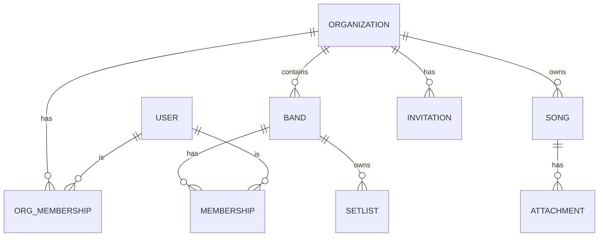

# ADR-0017: Organizations with a shared song library

- **Status:** Accepted
- **Date:** 2026-11-15

## Context

ADR-0005 models bands as the top level: songs belong to one band and are shared
between bands only by copying. The owner wants an **organization** above bands
(e.g. a music school, a church or a venue with several bands): its bands share
one song library, a correction to a song applies to all its bands, and nothing
is shared across organizations. People can belong to several organizations and
must only see the people of their own organizations.

## Decision

### Model

- **Organizations** have members with the role **admin** or **member**.
- **Every band belongs to exactly one organization.** Creating a band without an
  organization creates an organization with the band's name automatically, with the
  creator as its admin; for a single band the organization stays in the background.
- **Songs and their attachments belong to the organization** (shared library). Every
  member of the organization can see them; all bands of the organization use them.
- **Sets belong to a band** and reference songs of the band's organization.
- **Band memberships** (admin/member, ADR-0005) remain; only members of the
  organization can be members of its bands.
- **Invitations** (ADR-0005, issue #16) add people to the **organization**; band admins
  then add organization members to their bands. Organization admins manage all
  bands of their organization.
- **Users see only people of their own organizations** (names in member lists).
- The local library ("On this device", issue #15) is outside of any organization.

### Permissions

| Action | Who |
|---|---|
| See the organization, its people and songs | organization members |
| Create bands, manage people and roles of the organization | organization admins |
| See a band and its sets | band members (and organization admins) |
| Create, reorder, delete sets; band settings; add/remove band members | band admins and organization admins |
| Create, import and edit songs and attachments | organization admins, admins of any band of the organization, members of a band that allows song editing (`members_can_edit_songs`) |
| Delete songs and attachments | organization admins |
| Leave a band or an organization | the person themselves |

- An organization must always keep at least one admin, like a band (ADR-0005).
- Removing a person from an organization (or leaving it) also removes their band
  memberships in that organization.
- Songs are copied between organizations by export/import or "copy to band", never
  shared by reference.

### Server (ADR-0015)

New synced collections `organizations` and `org_memberships`; `bands.organization`;
`songs`, `attachments` and `invites` reference the organization instead of a band.
Delta sync filters songs and attachments by organization, sets and band memberships
by band.

## Alternatives considered

| Option | Pros | Cons |
|---|---|---|
| **Song library per organization** (chosen) | One correction for all bands; no duplicates | Song edit and delete rights span bands |
| Songs per band, copying only within the organization | Bands independent | Duplicates, corrections must be repeated |
| Songs per band with sharing by reference | Flexible | Most complex rules and UI |
| **Organization admins** (chosen) | Clear responsibility for people and bands | One more role level |
| Every organization member may create bands | Simpler | No control over the organization's bands |
| **Join the organization, then a band** (chosen) | People are known before they get a band | Two steps for a new member |
| Invitation directly into a band | One step | Organization membership as a side effect |
| **Organization always, created automatically** (chosen) | One model, no special cases | An extra record for single bands |
| Organization optional | Lean for single bands | Two code paths for sharing and visibility |

## Consequences

- Replaces parts of ADR-0005 (songs belong to a band; sharing between bands only by
  copy) and of ADR-0015 (collections and rules); both get decision log entries.
- The app (issue #15) groups the band switcher by organization; invitations (#16)
  target organizations. The songs tab chooses a **song library** (the local library or
  an organization); since #856 band and library are one selection across the app
  (see the decision log); sets, their song picker and Live mode use the library of the
  band's organization.
- The migration requires empty `bands`, `songs`, `attachments` and `invites`
  collections (true on 2026-11-15) and is not reversible; a restore needs a backup.

## Decision log

- 2026-11-15: Owner decisions: song library per organization, organization admins,
  people join the organization first, organizations created automatically for bands.
  Proposed with issue #21.
- 2026-11-15: Accepted by the owner, including the permission choices of PR #22
  (song deletion by organization admins only, organization admins manage all bands).
- 2026-11-16: Owner decision (#167): since songs belong to the organization, the songs
  tab no longer switches bands. It has its own library switcher ("On this device" and
  one entry per organization, also organizations without own bands), stored per
  device and independent of the band chosen on the sets tab; without a choice it
  follows the band. Song permissions and personal overlays (ADR-0020) follow the
  library of the song shown.
- 2026-11-22: Owner decision (#856), replaces "independent of the band" of 2026-11-16:
  the band (sets tab, overview) and the song library (songs tab) are **one selection**
  across the app, since two separate choices confused users and led to mistakes.
  Choosing a band chooses its organization's library (the local band the local
  library). Choosing a library keeps the band if it belongs to it, else chooses the
  band last chosen in that library, else its first band. An organization without a
  band of the user stays a song library: the sets tab and the overview then show a
  hint with *Manage bands* instead of the sets of another band.
- 2026-11-17: **ADR-0024** (accepted): on `invite_only` servers organizations are founded only by redeeming an operator founder invitation; creating a band without an organization is then rejected. On `open` servers the behaviour above stays.
- 2026-11-17: **ADR-0023** (accepted): organization roles admin > librarian > member instead of an organization-wide editing switch; existing songs are edited by organization admins and librarians, band leaders create songs and edit only their own; organization admins keep all rights.
- 2026-11-20: **ADR-0044** (accepted): an organization can be closed by any of its admins, with 30 days to restore it before everything is purged; bands can be deleted by organization admins.
- 2026-11-20: Closing an organization implemented (#629, ADR-0044): *Close organization* for its admins, *Closed organizations* to restore it within 30 days; the last admin who wants to end an organization closes it instead of leaving.

## Open points

- Moving a band to another organization.
