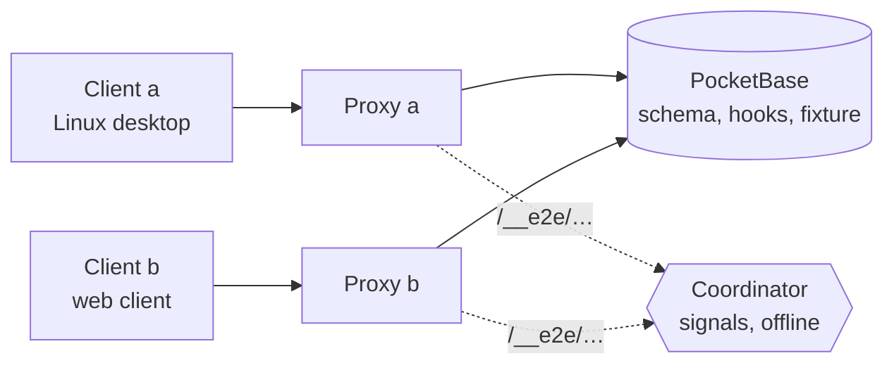

# End-to-end tests

The unit, widget and sync tests (`make check`) check one device at a time, or
two sync engines without UI (`app/test/sync_integration_test.dart`). The web
and Android integration tests ([web-tests.md](web-tests.md),
[android-tests.md](android-tests.md)) run the real app, but only one client.
The end-to-end tests in
[`app/integration_test/e2e/`](../../app/integration_test/e2e/) run **two real
clients on different platforms at the same time against one backend**: the
**Linux desktop app** and the **web client** in a browser, so the clients
change each other's data (issue #692). Like the other integration tests they
are **not part of `make check`**. `make release-gate` runs them before a
release.

## Running

```bash
make e2e                       # every story; the web client in headless Chrome
make e2e STORIES=basics        # one story
make e2e BROWSER=firefox       # the web client in Firefox
make e2e E2E_WINDOW=1          # show the browser and the desktop app
```

Requirements: the ones of [`make web-test`](web-tests.md) (Chrome or Chromium
with a matching chromedriver, or Firefox), plus the Linux desktop toolchain
of `make dev`. The desktop app needs a display. With `xvfb-run` installed
(Arch: `xorg-server-xvfb`, Debian: `xvfb`) it runs on a virtual display.
Without it, it uses the session's display and its window opens while the
test runs. On a machine without a display, `xvfb-run` is required.

The desktop app runs with its own data directory (`SETDING_DATA_DIR`,
`XDG_DATA_HOME`, as in `make dev`): your installation and its settings are
never touched.

## How it works

[`tool/e2e-test.sh`](../../tool/e2e-test.sh) runs each story:

1. [`server/bin/e2e_backend.dart`](../../server/bin/e2e_backend.dart) starts a
   fresh local PocketBase with the repository's schema and hooks and the
   fixture:
   - **Anna** administers the organization and leads the band "E2E Band";
   - **Ben** is an organization member and the band's set planner (ADR-0023);
   - **Carla** is a librarian of the organization (she edits and deletes
     songs) and also the band's set planner;
   - the library has *Fixture Song* and *Fixture Sheet*, a song with a
     two-page PDF only.

   It also starts **one proxy per client** in front of PocketBase
   ([`server/lib/e2e_coordinator.dart`](../../server/lib/e2e_coordinator.dart)).
2. Client b is built as the web client into the directory PocketBase serves
   (as in `make web-test`).
3. Client a starts as the Linux desktop app (`flutter test -d linux`) with its
   proxy as the server.
4. Once client a has signed in, the browser opens the web client through its
   own proxy, so its API is the page's origin, like in production
   (ADR-0018).
5. Both run until the end of the story. When one fails, the other stops
   waiting for it.



Both clients run in the **automatic sync mode**: realtime events and local
changes start a sync. The default mode only syncs at start and when the list
is pulled down (ADR-0004), so a story that relies on it must say so.

### Coordination between the clients

The two clients are separate processes, so a story must not depend on
timing. Each client reports a step with `signal(tester, 'song-created')`.
The other waits for it with `barrier(tester, 'song-created')`, which keeps
the app running (it pumps frames) while it waits. The endpoints sit under
`/__e2e/` on every proxy:

| Endpoint | Meaning |
|---|---|
| `POST /__e2e/signal/<step>` | the step is reached |
| `GET /__e2e/wait/<step>?timeout=<s>` | `200` once reached, `408` after the timeout, `410` when a client gave up |
| `POST /__e2e/abort` | a client failed; every wait answers `410` with the reason |
| `POST /__e2e/offline/<client>` / `online/<client>` | puts a client offline / online again |

**Offline** works like a lost network. New requests of that client fail at
the connection, and its open responses (the realtime connection) end. The
coordination endpoints keep working. This makes conflicts and the offline
queue reproducible: a client calls `setOnline(tester, online: false)`.

## The stories

| Story | Client a (Linux): Anna | Client b (web): Ben or Carla |
|---|---|---|
| `basics` | Creates a song, edits it while Ben has it open, plans a gig today with the song and the PDF-only song, then gets Ben's new order of the set | Sees the new song arrive without syncing by hand (realtime), sees the edit on the open song screen, starts the gig from the overview and plays it live including the PDF, then reorders the set as set planner |

| `conflicts` | Changes three songs and deletes two while Carla is offline with her own changes of them, and renames a set; then gets the result of each of Carla's resolutions | Offline: changes the same five songs, creates a song and renames the set, all held in the outbox. Online: each song is a conflict (ADR-0004), resolved on its screen: keep mine, use the server version, keep both; for a deleted song keep mine (restores it) and use the server version (accepts the deletion). Her queued song arrives, and her later push of the set wins (last writer wins) |
| `live` | Plans a gig today with three songs. While Ben plays it, she moves the last song to the front, edits the first and deletes the one Ben is on | Plays the gig live from the overview. Nothing of Anna's changes reaches his stage or his device while he plays (ADR-0007): the deleted song still plays, the old title stays. After he leaves live mode, the sync he missed runs: the set has Anna's order without the deleted song (no hint yet, #691) |
| `roles` | Deletes a song of a set and undoes it, deletes it again and restores it from the trash. Makes Ben a plain member while he is offline, then removes him from the band | Transposes the song for himself; Anna does not see it (ADR-0006). The undo brings back the song, its place in the set and his transposition; the trash brings back the song and his transposition, not its place (ADR-0043). Reorders the set offline as planner: back online he can no longer plan sets, the server refuses his change and it stays on his device (ADR-0004). Removed from the band: a notice, and the band is gone from his device (ADR-0044) |

## Adding a story

- Add `<story>_a_test.dart` and `<story>_b_test.dart` to
  `app/integration_test/e2e/`. One `e2eTest` per file, and it calls `main()`
  (web: `startApp()`).
- Name the steps of a story uniquely: a step stays reached until the story
  ends.
- Use the helpers of
  [`e2e_support.dart`](../../app/integration_test/e2e/e2e_support.dart)
  (`signal`, `barrier`, `eventually`, `setOnline`, `signInOnDesktop`,
  `selectFixtureBand`, database lookups) and, in the web client,
  `signIn` / `pressKey` from `web/web_support.dart`. Text goes in with
  `enterText` on Linux and with `fillIn` on the web.
- Check what the person sees through the UI. Changes may go through the
  app's repositories, the same code the UI calls.
- Give every client step a deadline (`pumpUntil`, `eventually`, `barrier`),
  never a fixed `sleep`. Only a check that something does *not* happen
  (live mode does not sync) watches for a fixed while (`pumpFor`).

## Not covered

Android, iOS and Windows as clients (Android could join as a third client
through `adb reverse` onto its own proxy), and Safari.
